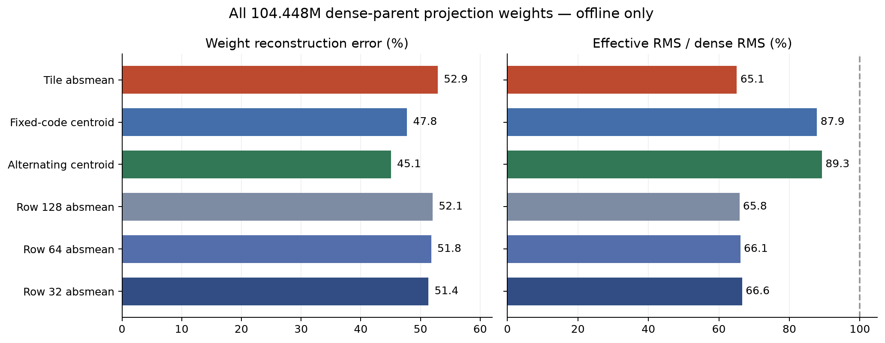
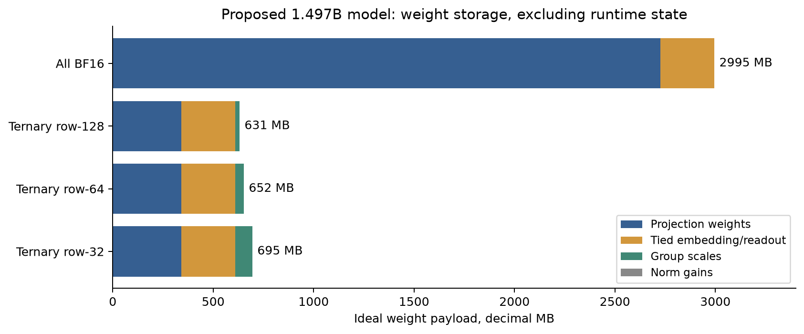

# Terminus: architecture and training design for dense FP8 followed by ternary QAT

**Research and engineering proposal — 5 October 2026**

This document proposes a concrete model family and a way to tune it. It addresses the completed 10B-token dense run and 2B-token QAT continuation, the actual Terminus implementation, and research beyond MiniCPM4. It makes no decision about launching the main run. The proposed architecture has not been trained; “preferred” means the strongest starting hypothesis from this review, not a measured optimum.

The companion [research evidence](RESEARCH_EVIDENCE.md) documents primary sources and applicability limits. [Source receipts](source_receipt.json) record retrieved content hashes and revisions. [Design measurements](design_measurements.json) contain exact parameter/storage arithmetic and new offline measurements on the verified dense checkpoint. The earlier [combined run report](../../../experiments/terminus_lean_150m_qat_2b/analysis/COMBINED_DENSE_QAT_SCALING_REVIEW.md) remains the detailed record of the completed runs.

## 1. The proposed starting point

My preferred family is a **25-layer, bias-free, pre-RMSNorm decoder with runtime residual scaling, SwiGLU, learned Q/K normalization, and 4:1 local/global attention**. The target profile is **width 2048, FFN width 7168, 16 query heads and 4 KV heads, head dimension 128**, with the frozen 65,536-piece tokenizer and tied embedding/readout. It contains **1,497,477,376 trainable parameters** before any optional learned ternary scales.

Dense training uses FP8 E4M3 projection arithmetic with FP32 master weights and gradients. Ternary training retains FP8 activations and uses a distinct ternary representation followed by FP8 arithmetic. The preferred QAT experiment starts with **64-weight groups within each output row**, independently of the 128×128 weight tiles used by DeepGEMM. The current tile-wide quantizer remains an essential comparison. Calibrated and learned scales are additional candidates, not assumed wins.

The biggest changes are a coherent scale parameterization, separate optimizer treatment of small gains and embeddings, and separation of ternary grouping from GEMM layout. Keeping local/global attention, main RMSNorm, SwiGLU, projection fusion, and Muon avoids replacing components that already have substantial supporting evidence.

An architecture alone cannot produce an excellent model. Data quality, task coverage, token budget, the dense-to-QAT schedule, and appropriate post-training remain major determinants of quality. The objective here is to make those experiments interpretable and to give them a strong architectural foundation.

## 2. What the existing evidence does and does not show

### 2.1 Quality and numerical stability are different measurements

The dense model finished at 2.4194 NLL under the original mixture. On the QAT mixture, evaluating the **same dense checkpoint** gives 2.3154; the final QAT checkpoint gives 2.4889. Every tracked source is worse after QAT. English is 2.7597 → 2.9857, code 0.6389 → 0.7208, and math 1.1989 → 1.3165. These are per-token natural-log losses, not task scores.

Both stages completed without non-finite incidents. That rules out a recorded numerical blow-up, but it does not establish a good optimizer recipe, a well-calibrated conversion, or optimal capacity allocation. QAT recovered substantially from its immediate 10.517 weighted loss, and continued improving during decay. Calling the entire QAT process a failure would ignore that recovery; calling it quality-preserving would ignore its final gap.

The QAT training mixture changed from 50/10/10/30 English/code/math/Indic to 37/13/13/37 because fresh English was limited. Consequently, the final dense-to-QAT difference combines quantization, extra training, LR history, and changed data exposure. A same-data dense continuation isolates more of the quantization effect. The **immediate** conversion shock is a much cleaner indication of functional disturbance from the weight-mode change.

### 2.2 The strongest observed representation anomalies

- The first attention RMSNorm gain finishes at full-vector RMS **0.0165** after dense training. Its attention branch output is about **0.076 RMS**, versus **3.18** for the first FFN branch.
- QAT raises that gain RMS to **0.0546**, but the first attention output remains around **0.076**. One gain coordinate accounts for **75.3%** of that vector's squared magnitude.
- Last-layer attention output rises from **3.09 to 20.76 RMS** after QAT. Last-layer residual RMS rises from **34.37 to 48.28**.
- Projection master RMS rises by approximately **1.5–2.1×** during QAT; K has the highest final ternary reconstruction error and zero fraction.
- The tied embedding/readout remains unquantized, yet moves by **0.692 relative RMS** from dense to QAT. It is participating strongly in adaptation.

These are reasons to measure functional contribution, not proof that a branch is useless or a tensor should be clipped. A small branch can matter on rare examples. Large coordinates can implement structured functions; the Massive Activations paper is relevant counterevidence to treating every large value as a defect [S20].

### 2.3 A hierarchy of possible causes

**Directly observed or verified in code:** scale migration; broad conversion shock; all-source QAT loss gap; coarse ternary groups; initialization-only residual scaling; identical peak base LR for norms and other groups; changed data mixture; limitations in the telemetry; and several prospective tuning-interface issues.

**Strong hypotheses:** the initial small residual weights are not maintained as small updates under Muon; norm and embedding learning rates encourage compensating scale changes; the quantizer shrinks branch amplitudes and changes directions; QAT needs a different rate/horizon/mix; the tiny proxy has less capacity to absorb extreme quantization than a larger model.

**Still unmeasured:** trained-weight native/reference differences, the causal importance of first-layer attention suppression, task-quality impact of the conversion, the best ternary group size, the best residual precision, and the transfer of any candidate to a wider model. None is resolved by inspecting final weight norms alone.

## 3. What to learn from MiniCPM4, and where Terminus differs

### 3.1 Copy the complete idea behind the learning rate

The original MiniCPM paper describes embedding scaling, runtime residual scaling, width-dependent initialization/LR rules, and readout scaling. The released MiniCPM4-0.5B code implements residual additions of the form

$$x_{l+1}=x_l+\frac{\mathrm{scale\_depth}}{\sqrt{L}}F_l(x_l).$$

Its released config has `scale_depth=1.4`, `scale_emb=12`, and `dim_model_base=256`. Those facts are directly visible in code [S2]. Terminus instead shrinks O/down weights at initialization and adds subsequent branch outputs without a runtime multiplier. It also uses a different embedding/readout scheme and Muon updates. The same number `0.01` therefore describes different training dynamics.

The solution is a declared parameterization, measured initial activation/logit scales, and empirical width transfer. It is not simply changing Terminus's LR to another number copied from a paper.

### 3.2 Copy re-warmup and controlled schedule comparisons

MiniCPM4 reports dense initialization followed by QAT, independent re-warmup, and an allocation sweep at fixed total tokens. Its pilot's >40% QAT result is about approaching a ternary-from-start baseline. It does not prove that every dense model recovers its full-precision quality with that fraction [S1].

Our actual QAT consumed 2B after a 10B dense run: **16.7% of the combined 12B**. Dense decay consumed 2B, so the continuation equaled dense decay rather than twice it. Applying the paper's wording gives a testable 4B candidate, not an optimum. More tokens, an altered decay, and a different peak should be compared under explicit total-cost and total-exposure budgets.

### 3.3 Use the newer BitCPM evidence as well

BitCPM-CANN uses absmean ternarization and identity STE, so those choices are not inherently invalid. Its 0.5B experiments found better decay loss with row groups of 32 than 64, and with both than per-channel scaling. It also found **0.01 QAT LR better than 0.005**, while 0.015 degraded [S4]. That argues for tuning group size and LR independently, including rates above and below the present baseline in the appropriate parameterization.

The same report found better results from QAT followed by distillation than from simultaneous distillation throughout QAT. It also reports greater reasoning degradation in its smallest model. These findings motivate a later distillation phase and caution against using the absolute quality of a 150M ternary proxy as the expected 1.5B result.

MiniCPM4 additionally used MTP and extensive data selection. A reproduction that copies only the dense/QAT transition omits important parts of its quality recipe. Those parts deserve their own cost-controlled experiments.

## 4. Exact architecture and capacity allocation

| Component | Preferred starting specification |
|---|---|
| Vocabulary | Frozen 65,536-piece artifact; unchanged IDs and normalization |
| Layers | 25; five complete local/local/local/local/global cycles |
| Hidden width | 2048 |
| SwiGLU intermediate width | 7168 = 3.5× hidden width |
| Query / KV heads | 16 / 4; head dimension 128 |
| Local window | 512 causal tokens, including the current token |
| Initial context | 4096; longer context is a separate training/evaluation variable |
| Main normalization | Learned pre-attention RMSNorm, learned pre-FFN RMSNorm, final RMSNorm |
| Attention normalization | Learned head-dimension Q and K RMSNorm, before RoPE; no V norm |
| Residual parameterization | Fixed runtime multiplier on each branch; separately tunable from LR |
| Embedding/readout | Tied; explicit input scale and readout scale |
| Other structure | No linear biases, no SubLN, no extra embedding projections, dropout 0 |
| Precision | FP8 projection operands; BF16 attention operands; FP32 master weights, gradients, norm statistics, optimizer states |
| Projection optimizer | Muon with logical Q/K/V and gate/up partitions |

The parameter calculation is

$$P=L(2d^2+2d\,h_{kv}d_h+3df)+Vd+(2L+1)d+2Ld_h.$$

The final term assumes one learned Q gain vector and one K gain vector of length 128 per layer, **shared across heads**, as in a head-dimension RMSNorm. It is not a distinct 128-vector for every head.

For the proposed target:

- Projection matrices: **1,363,148,800** parameters.
- Tied embedding/readout: **134,217,728** parameters.
- Main/final RMSNorm gains: **104,448** parameters.
- Q/K RMSNorm gains: **6,400** parameters.
- Total: **1,497,477,376** parameters.

### 4.1 Why width 2048 and FFN 7168

The historical width-2304 / FFN-5760 / 18-query / 6-KV model has almost the same total count, about 1.500B with Lean main norms. The proposed shape moves some capacity from attention width and KV projections into the FFN, uses common hardware-aligned dimensions, and gives a simple family with a consistent head dimension and GQA ratio. QKV output width is 3072; packed gate/up width is 14336. All are aligned to 128.

This is an engineering and capacity-allocation hypothesis. It is **not** evidence that 2048 always beats 2304. The paired shape comparison should score both dense quality and final ternary quality at matched actual cost. FFN width matters for factual/language capacity and for reconstructing representations under low-bit weights; attention width matters for communication and head capacity. Parameter count alone does not settle that trade-off.

If depth is reopened beyond the previous 25-layer preference, a serious comparator is **30 layers, width 2048, FFN 5632, 16/4 heads**, about **1.487B parameters** with six 4:1 local/global cycles. It trades FFN width for more sequential transformations, additional attention layers, and a larger cache. This is a meaningful fixed-budget depth/FFN comparison; it is not part of the width-transfer family and should not be conflated with its LR transfer.

I would not introduce MoE, MLA, recurrent layers, mHC, or a learned sparse indexer into this baseline. Each changes the scaling study and adds routing, kernel, or quantization questions. Their relevance can be revisited if measured quality or serving cost justifies them.

### 4.2 A geometry-consistent proxy family

| Width | FFN | Query / KV | Parameters |
|---:|---:|---:|---:|
| 512 | 1792 | 4 / 1 | 118,783,744 |
| 1024 | 3584 | 8 / 2 | 407,954,688 |
| 1536 | 5376 | 12 / 3 | 867,519,232 |
| 2048 | 7168 | 16 / 4 | 1,497,477,376 |

All use 25 layers, head dimension 128, GQA ratio 4:1, FFN ratio 3.5, and the same vocabulary. The existing 146M model remains useful for diagnosing its own run, but its five query heads and single KV head do not belong to this exact geometry family. There is no need to force a round 150M count by changing head dimension or FFN ratio in the smallest transfer proxy.

Even this consistent family changes the embedding fraction: 28.25% at width 512 versus 8.96% at width 2048. Record projection and embedding costs separately when judging transfer. The 867M point is optional; a cost-limited search need not train every intermediate size.

## 5. Residual parameterization and initialization

### 5.1 The proposed block equations

With learned channel gains in RMSNorm:

$$u_l=\mathrm{RMSNorm}_{a,l}(x_l),$$
$$\tilde x_l=x_l+s_a\,W_{o,l}\,\mathrm{Attention}(u_l),$$
$$v_l=\mathrm{RMSNorm}_{f,l}(\tilde x_l),$$
$$x_{l+1}=\tilde x_l+s_f\,W_{d,l}\left[\mathrm{SiLU}(W_{g,l}v_l)\odot W_{u,l}v_l\right].$$

Start with $s_a=s_f=c/\sqrt{2L}$ and $c=1$, giving **0.1414 at 25 layers**. Test $c\in\{0.5,1,2\}$ at the proxy. This convention makes the total number of residual branches explicit; MiniCPM's `scale_depth/sqrt(L)` is another parameterization, not an extra factor to multiply on top.

Initialize **all** projection matrices with standard deviation $1/\sqrt{\mathrm{fan\_in}}$ in this proposal. Do **not** also shrink O/down initialization by 0.1414. Runtime scaling already supplies the branch factor. Double application would create a different model with much smaller initial branch outputs.

These are explicit starting coordinates, not a complete proven $\mu$P construction. The scaling factors remain fixed during each run so they do not become another hidden optimizer interaction. After measuring the shared factor, a separate attention-versus-FFN factor can be tested if the two branches behave differently.

### 5.2 Why initialization-only scaling is insufficient evidence of controlled updates

Current O weights initialize around **0.00557 RMS**, and down weights around **0.00345 RMS**. With the implemented RMS-matched Muon convention, a base LR 0.01 corresponds approximately to **0.002 update RMS** before accounting for polynomial approximation and weight decay. Relative to the *initial* weights, those are large scales. They are not actual measured peak update ratios, because weights have already changed during warmup.

The logged samples show that change: first-layer down-weight RMS is about 0.00351 at update 1, 0.0582 at update 1000, and 0.1417 near the warmup end. At the same points, the first attention norm gain falls from 1.0 to about 0.559 and 0.039. These observations are consistent with scale migration but do not establish its sole cause.

Muon normalizes the update direction. Multiplying all gradients by a small scalar does not generally make the orthogonalized update proportionally small. A runtime branch multiplier directly controls the effect of a parameter change on the residual stream; it addresses a different issue from initialization. Retune LR with it, rather than trying to preserve the old LR by analogy.

### 5.3 Embedding and logit initialization

For a transparent starting scheme, initialize tied embedding entries with standard deviation $1/\sqrt d$, set the input embedding multiplier to $\sqrt d$, and set the readout multiplier to $c_{\mathrm{logit}}/\sqrt d$, starting with $c_{\mathrm{logit}}=2$. This makes the **initial input residual RMS approximately 1** and controls a specific tied-embedding correlation: the residual stream initially contains the current token's own embedding.

The equations are

$$x_0=\sqrt d\,E[t],\qquad z=\frac{c_{\mathrm{logit}}}{\sqrt d}\,E\,\mathrm{RMSNorm}_{\mathrm{final}}(x_L),\quad c_{\mathrm{logit}}=2.$$

With a strong residual identity path, treating the readout and hidden vector as independent is wrong: an unscaled self-token logit can grow like $\sqrt d$. The [initialization diagnostic](initialization_diagnostic.json), using the proposed width-512 block equations and random token IDs in FP32, measured a **99.97% mean probability on the current token** with an unscaled readout. With $2/\sqrt d$ scaling, entropy was **11.086 nats**, close to the 65K uniform entropy of **11.090**, and mean self-token probability was about **0.0087%**. This is an initialization check, not real-data evaluation or evidence of convergence.

This is not a claim that the embedding stays unit-RMS after learning, or that tied embedding gradients are width-invariant. Input and output uses share one matrix and have different gradient paths. Check their gradient contributions and tune embedding LR accordingly. Test an input-RMS target of 0.5/1/2 and $c_{\mathrm{logit}}\in\{1,2,4\}$ under a fixed width rule. Avoid simultaneously moving embedding scale, final gain, and logit temperature without an identifying control. The explicit readout scale must be included in the Muon/auxiliary-LR transfer study; correcting initialization does not prove a width-transfer theorem or rule out slow later learning.

The current unscaled embedding initializes near 0.0395 RMS at width 640, which makes early residual additions large relative to the input stream. That is another plausible contributor to its adaptation. Small initial token embeddings are not intrinsically wrong, but the entire residual/optimizer parameterization must account for them.

## 6. Normalization: keep the useful functions, isolate the unnecessary ones

### 6.1 Main pre-RMSNorm

Keep the two main learned RMSNorms per block and final RMSNorm. Use FP32 mean-square reduction, epsilon $10^{-5}$ initially, and gains initialized to 1 in the proposed scheme. Optimize gains separately from projection matrices, with zero weight decay and a much smaller starting LR. Negative gain coordinates are allowed; their sign alone is not an instability.

The first-layer gain anomaly suggests a rate/parameterization experiment, not automatic gain clipping. Compare the current learned gain with a lower-LR learned gain and a fixed unit-gain diagnostic. If the gain falls under all rates but removing its attention branch changes no held-out predictions, suppression may be functional. If lower LR improves loss and restores useful attention, that is evidence for an optimization cause.

Unit-gain diagnostic norms and post-FFN SubLN are different operations. Removing all norms because some old protections were conservative would conflate those jobs. Conversely, adding OLMo2 output norms on top of existing pre-norms would test a new architecture; OLMo2's paper does not establish that such stacking is helpful here [S11].

### 6.2 Learned Q/K normalization

Use Q/K RMSNorm **after Q/K projection and before RoPE**, with one learned head-dimension gain per Q and K module. Apply the standard attention scale $1/\sqrt{128}$ once. V remains unnormalized. No separate learned attention temperature is needed initially because Q/K gains already provide scale freedom.

Rationale: Qwen3 combines this with a bias-free pre-RMSNorm/GQA/SwiGLU backbone [S10]; small-model instability studies directly examine attention-logit growth [S12]. It can also make attention less sensitive to changes in the amplitude of quantized Q/K projections. It cannot repair a changed Q/K direction, lost information, or a collapsed upstream attention input.

This is the one additional normalization I would include in the preferred architecture, paired with an otherwise identical no-QK-normalization control. It adds only 6400 parameters at 25 layers, but parameter count is not latency: the operation and its backward must be fused and timed. Existing packed QKV kernels support gain-free normalization; learned gains and gain gradients require extending that path.

### 6.3 What to leave out initially

No attention-output SubLN, no SwiGLU-output SubLN, no global activation clipping, no universal logit soft-cap, no positive-only gain constraint, and no per-layer arbitrary stabilizer stack. Each would need a specific measured failure and a paired quality/cost result. Small targeted scale controls are preferable to accumulating independently motivated changes whose interactions cannot be identified.

## 7. Attention, local/global structure, and position

### 7.1 Keep the 4:1 pattern and 512 window as the baseline

Place global layers at one-based indices **5, 10, 15, 20, 25**. A local layer sees 512 causal positions including the current token. The final layer is global, so its output can use direct long-range attention immediately before the readout.

Four local layers expand the theoretical receptive field to $1+4(512-1)=2045$ positions before the first global layer. Receptive-field reach does not mean every remote detail survives through intermediate states. A global layer supplies a direct content-dependent path to distant tokens, so it is not redundant merely because prior local layers propagate information.

Gemma3's local/global and window-size ablations support the general approach [S13]. They do not prove our exact 512/4:1 setting optimal. Useful tests include local windows 256/512/1024, long-document loss by position, retrieval, and code dependencies crossing window boundaries. Varying global-layer placement while preserving five globals is a separate architecture experiment.

### 7.2 Quantified costs for the proposed target

At context 4096, the exact causal attention-pair count of this 20-local/5-global pattern is about **38.75%** of an all-global 25-layer model. The often-used $0.2+0.8(512/4096)=0.3$ estimate does not count causal triangular pairs correctly. Neither ratio is the end-to-end throughput ratio: projection GEMMs, FFNs, loss, and optimizer work remain.

For BF16 KV storage, four KV heads, head dimension 128, and batch one, capped local caches need approximately **60 MiB at 4K**, versus **200 MiB** for all-global attention. At 32K those values are about **340 MiB versus 1600 MiB**. These are ideal cache payloads, excluding allocator padding and other runtime state.

### 7.3 GQA and head dimension

Four KV heads at width 2048 give a moderate 4:1 query/KV ratio. One KV head at the old 640-width proxy was an economical choice, but it is not evidence that one KV head is sufficient at every scale. Keep head dimension 128 for H100/FA3 and quantizer alignment, and test KV capacity with dense **and** ternary evaluation because K/V information loss may interact with sharing.

A head-dimension-64 comparator can retain total Q/K/V widths by using 32 query and 8 KV heads at width 2048. It changes head granularity and softmax work while leaving projection parameter counts essentially unchanged. It is a legitimate later attention-shape test; the preferred 128 setting preserves the existing head-size contract and simplifies the initial comparison.

Do not infer that K must remain dense simply because its weight-space error is highest. Keep-only-K-dense is a diagnostic. It tests whether that small parameter family has disproportionate functional importance; its outcome can guide calibration, group size, LR, or a consciously mixed-precision serving design.

### 7.4 RoPE and long context

Use ordinary RoPE with theta 10,000 at the initial 4K context for an easily interpretable baseline. Do not import a million-base or long-context interpolation schedule solely because another model uses it. A long-context phase can compare scaled RoPE, distinct local/global bases, and hybrid NoPE, with retrieval and positional evaluations.

SmolLM3's NoPE experience is useful [S14], but removing RoPE from global layers changes inductive bias and is not required to fix the current short-context run. Position IDs, cache offsets, document boundaries, and training/inference window conventions must be identical across backends.

## 8. FFN, embedding, and readout choices

### 8.1 SwiGLU

Keep a bias-free gated FFN and packed gate/up projection. SwiGLU is well supported by the MiniCPM/Qwen family and already has fused forward/backward support here. A gate and an up matrix are distinct logical Muon matrices even if they share a physical tensor.

Measure gate preactivation tails, SiLU saturation, up-activation tails, product RMS, and down-output/residual ratio. A large FFN value does not automatically imply the gate needs clipping. If outliers damage FP8 resolution, first compare granularity and scaling before adding another normalization or replacing the activation.

ReLU-squared is a valid lower-complexity candidate but changes the number/shape of matrices and capacity at fixed width. It deserves an equal-parameter/equal-cost experiment, not a nominal activation-only comparison. The preferred model keeps SwiGLU until that comparison exists.

### 8.2 Tied embeddings

Keep the full 65K embedding/readout tied initially. At the proposed target it is 8.96% of parameters, substantially less than the old proxy's 28.64%. Untying adds 134.2M parameters and another large unquantized tensor; it must compete at a fixed budget rather than receiving extra capacity for free.

Start with no embedding weight decay, motivated by OLMo2 and SmolLM3 [S11, S14], and a dedicated AdamW LR. Because the embedding is tied, this also changes regularization of the readout; assess vocabulary-tail quality and logit behavior. A zero-decay choice that helps another architecture is not a guarantee here.

Avoid factorizing the embedding merely to manufacture a tiny proxy. It creates a different rank bottleneck and can harm rare-language vocabulary coverage. Avoid reducing the tokenizer or pruning vocabulary as part of this architecture study: the owner has already fixed the tokenizer.

### 8.3 Output loss implementation

Keep exact next-token cross-entropy over the vocabulary, implemented with a memory-efficient fused or chunked linear-plus-cross-entropy operator. Accumulate reductions in FP32 or higher where appropriate. Verify gradients to **both** hidden states and the tied matrix against the explicit reference; the readout is a substantial part of the proxy's computation and learning signal.

Label smoothing is off initially. Output-logit z-loss is a targeted candidate at a small coefficient such as $10^{-5}$ if log-partition drift appears, following relevant OLMo2/proxy evidence [S11, S12]. Report CE separately from any auxiliary term. A soft-cap or z-loss can alter calibration; neither should be silently treated as a free numerical fix.

## 9. Muon and every optimizer group

### 9.1 Keep logical Muon partitions

The implementation already orthogonalizes Q, K, and V separately within QKV and gate/up separately within their fused tensor. Preserve that. Do not orthogonalize the whole packed QKV matrix and assume it is equivalent: the shape and joint constraint change.

Muon updates are only approximately polar/orthogonal updates at finite Newton–Schulz iterations. The pinned implementation uses five iterations and specified polynomial coefficients, so even “exact orthogonal update RMS” is an approximation. Keep the polynomial, momentum convention, and correction factor recorded in the run contract.

Global gradient clipping remains useful for handling non-finite or extreme raw gradients, but **it does not directly bound the subsequent Muon parameter update**. Orthogonalization is approximately scale-invariant and momentum depends on prior steps. Record actual post-optimizer update norms; do not declare safe updates based only on clipped gradient norm.

### 9.2 Starting rates and search brackets

The table gives a **width-512 proxy starting point**, not transferred target rates. Architecture, initialization, and runtime scaling differ from the old run, so rates must be re-ranked.

| Group | Starting optimizer / setting | Initial comparison |
|---|---|---|
| Q, K, V, O, gate, up, down | Muon base LR 0.003; momentum 0.95; WD 0.1 | Base LR 0.0015 / 0.003 / 0.006; old recipe as a distinct reference |
| Tied embedding/readout | AdamW LR 0.001; betas (0.9, 0.95); WD 0 | LR 0.0003 / 0.001 / 0.003; WD 0 versus 0.1 |
| Block main RMSNorm gains | AdamW LR 0.0003; WD 0 | 0.0001 / 0.0003 / 0.001 |
| Final RMSNorm gain | Separate AdamW group, initial LR 0.0003; WD 0 | Independent multiplier 0.3 / 1 / 3 after the coarse search |
| Learned Q/K gains | Separate AdamW group, initial LR 0.0003; WD 0 | Same LR bracket; paired no-QK control |
| Optional learned ternary scales | AdamW, gradient scaling defined by the quantizer | Separate scale LR; never inherit projection Muon LR |

Use epsilon $10^{-8}$ initially for auxiliary AdamW. Test matrix WD 0.03/0.1/0.3 only after an approximate LR range is established, and inspect whether changing it improves loss rather than merely shrinking weights. QAT gets its own rates and may prefer a different optimizer for projections; a single well-matched AdamW QAT control is informative if Muon behaves poorly with the selected STE.

Do not sweep all seven logical projection multipliers immediately. Start shared, then use sensitivity measurements to prioritize a Q/K multiplier and an O/down multiplier. This reduces tuning dimensions while still allowing every family to be examined.

### 9.3 Group-by-group diagnosis and experiment

**Q:** inspect head-specific query RMS, attention-logit spread, positional retrieval, and directional quantization error. Test learned Q/K norm, ternary group size, and Q LR. Restoring amplitude alone cannot restore changed query directions.

**K:** inspect each KV head and its shared query heads. Current K has high reconstruction error, but a zero-code fraction is not a capacity metric. Use a keep-K-dense control, finer row groups, and attention-score/output comparison to establish sensitivity. More KV heads is a separate capacity/cost change.

**V:** measure value-vector error and attention-weighted value output, not just V-matrix distance. QAT doubled its latent RMS. Test whether this is harmless compensation or whether it amplifies residuals through O.

**O:** measure attention branch contribution before and after the runtime residual multiplier. Separate upstream score changes from O-weight growth. A shared O/down LR multiplier is a sensible first residual-output ablation.

**Gate:** inspect saturation and discrete-code flips near threshold, especially on math/code and rare scripts. Test calibration or group size before introducing activation caps.

**Up:** inspect product statistics jointly with gate. Gate/up can compensate each other's scale, so their individual weight RMS is not enough to judge either one. Keep separate Muon orthogonalization even when testing a shared LR multiplier.

**Down:** inspect its output/residual ratio and update-to-weight ratio. Its small old initialization and large later growth make it a direct test of the runtime-scaling hypothesis.

**Embedding/readout:** separate input-lookup gradients from output-softmax gradients on diagnostic batches, examine rare-token frequency bins and languages, and test LR/WD. The tied matrix's QAT drift is real; freezing it is a diagnostic, not a preferred default.

**Main gains:** report full-vector distributions, squared-mass concentration, and functional branch ablations. A vector with one dominant coordinate can be missed by 256-coordinate sampling.

**Final gain:** inspect logit RMS, log-sum-exp, calibration, and entropy. Keep its LR distinct because it controls readout temperature more directly than interior norms.

**Q/K gains and learned scales:** record actual gradients and update magnitudes separately. These are small or scalar-like parameters with different optimization geometry from the projection matrices.

### 9.4 Width transfer without assuming the answer

The existing Muon rule is equivalent to an approximate RMS-matched update proportional to $0.2\sqrt{\max(m,n)}$ times the polar-like matrix. It already compensates WD so that the base $\eta\lambda$ is preserved. That implementation is not a double-decay error.

A useful empirical extension is to compare width corrections

$$\eta_W(d)=\eta_0\,s_{\mathrm{Muon}}(W)\left(\frac{d_0}{d}\right)^p,\qquad p\in\{0,\tfrac12,1\}.$$

Here $p=0$ retains the present RMS-matched convention. This bracket is an experiment, not a $\mu$P theorem. Embedding/readout scaling, auxiliary LRs, and initialization must be held coherent while testing it. Record whether the LR optimum, activation scales, and update effects transfer at width 1024 before attributing success to any rule.

Recent work shows Muon and $\mu$P-style transfer can coexist [S9]. It does not establish that an arbitrary extra $1/d$ readout factor on our current model is safe. The full parameterization and horizon matter. Width transfer and optimal LR versus training-token horizon are separate questions.

## 10. FP8 numerical design and systems constraints

### 10.1 Preserve FP8 activations

Activation FP8 is a requirement here. DeepSeek-V3 provides evidence that E4M3 can be used for forward and backward with fine-grained online scaling and sufficient accumulation precision [S15]. Keep per-token 1×128 activation scaling, FP32 masters/gradients and optimizer state, and BF16 interfaces where required by attention. Do not introduce FP8 optimizer-state compression as part of the initial quality study.

Explicitly record the formats for forward inputs, forward weights, dgrad operands, wgrad operands, accumulators, saved tensors, residual state, norms, attention softmax, and loss. “FP8 model” does not specify this precision map.

### 10.2 Two different reference comparisons

**Operator emulation:** native kernels versus a transparent reference using the same quantized values, scale layouts, STE, masks, and accumulation contract. This finds implementation errors.

**Precision ablation:** the FP8 recipe versus a genuinely BF16 training recipe on matched data and seed. This measures the quality cost of the intended approximation. These comparisons have different expected tolerances; a numerical difference from BF16 is not automatically a kernel bug.

Test trained distributions for Q/K/V/O/gate/up/down, small gradients, outliers, non-contiguous views, tails, and large reductions. Include fused versus unfused RMSNorm, packed SwiGLU, RoPE, loss, and optimizer updates. A 2–3% sampled input-quantization error does not validate dgrad, wgrad, or end-to-end training.

### 10.3 Residual precision

The throughput-oriented baseline stores the residual in BF16, with FP32 arithmetic/statistics inside fused addition/normalization as implemented. A control keeps the persistent residual stream in FP32 while retaining FP8 GEMMs. FP32 arithmetic followed by a BF16 store is **not** equivalent to persistent FP32 storage.

Measure the fraction of residual coordinates for which a nonzero branch addition disappears after BF16 rounding, plus the accumulated effect on loss. Large residual RMS by itself does not tell us how often this happens. If the persistent-FP32 control improves quality at acceptable cost, its memory cost becomes a measured design trade-off.

### 10.4 Reuse systems work with the chosen mathematics

Keep FA3, projection fusion, cached quantized weights per optimizer update, fused pointwise kernels, and fused loss. Evaluate compatible upstream DeepGEMM weight-gradient/JIT improvements before budgeting new GEMM work [S19]. Read COAT and CODA for fusion patterns [S16, S17].

Gram Newton–Schulz is especially relevant to rectangular K/V and FFN matrices [S18]. A 2× faster NS component does not mean 2× faster training. Match coefficients, iterations, momentum, shape corrections, and numerical behavior before replacing the current implementation; the library's default optimizer may differ from ours.

Profile optimizer-inclusive update time, validation/checkpoint overhead, and data wait separately. Preserve actual end-to-end tokens/s as the budget metric. Better kernels increase the number of quality experiments affordable; they do not establish better model quality directly.

### 10.5 Distributed execution must preserve the optimizer

Data parallelism can preserve the logical Muon update by reducing full logical gradients before orthogonalization. A ZeRO-style owner can hold a complete logical matrix update and communicate the result. Applying Muon independently to arbitrary flattened FSDP or tensor-parallel shards is a **different optimizer**, because polar/NS operations are not generally separable across those shards. A multi-GPU implementation needs an explicit full-matrix or mathematically justified distributed update contract.

Tensor-parallel boundaries also need to respect ternary groups, FP8 tiles, and logical Q/K/V slices. Document whether scales are local to an aligned shard or require a reduction. Normalize losses by the global valid-label count and preserve the intended accumulated batch. These are correctness details for comparing a single-H100 proxy with a distributed target, not merely throughput settings.

At the proposed target, FP32 projection masters, gradients, and Muon momentum alone use roughly **16.36 GB**. The tied embedding's FP32 weights, gradients, and two Adam moments add about **2.15 GB**. Cached FP8 projection weights in two orientations add about **2.73 GB**, before activations, attention workspaces, readout casts, scales, and allocator overhead. This explains why a small exported ternary model still needs substantial training memory. It is not a measured peak-memory prediction.

## 11. Ternary representation: the central architectural interface to fix

### 11.1 What the current converter does

For each 128×128 block, Terminus computes $\alpha=\mathrm{mean}|W|$ and

$$Q(W)=\alpha\,\mathrm{clip}(\mathrm{round}(W/\alpha),-1,1).$$

All 16,384 weights share one scale. On the dense checkpoint this gives **52.91% relative RMS reconstruction error**, **31.70% zeros**, and effective weight RMS **65.10%** of the original. Q and K individually shrink to approximately 0.641 and 0.623 of their original RMS.

A scale-only thought experiment would multiply those Q/K factors to about 0.40 in attention scores. The V/O scale product is also substantially below one. FFN products involve multiple changed matrices and a nonlinear SiLU. These are explanations of why amplitude matters, not predictions of actual model logits: quantization changes directions and correlations too.

### 11.2 Separate the ternary grid from FP8 compute tiles

Use two explicit objects:

$$W_T=Q_{\mathrm{ternary},g}(W_{\mathrm{master}}),$$
$$W_{\mathrm{GEMM}}=Q_{\mathrm{FP8},128\times128}(W_T).$$

The preferred new QAT branch uses $g=64$ adjacent input coordinates within each output row. Activation FP8 stays 1×128, and DeepGEMM retains its supported weight-tile format. This decoupling permits finer ternary groups without requiring a new GEMM kernel. It **does** require a correct quantizer/STE adapter and an extra FP8 encoding step; its speed and quality cost have not been measured.

The exact exported model uses ternary codes plus their group scales. Its FP8 execution is an arithmetic approximation to that representation. During validation, compare native FP8 execution with a BF16 evaluation of the same ternary representation so the extra encoding error is visible.

For aligned row groups of 32/64/128 wholly contained inside an FP8 tile, symmetric FP8 encoding rounds each group's shared nonzero magnitude consistently. The group still has a scaled {-1,0,1} form with a rounded effective scale, except that sufficiently small magnitudes can underflow to zero. That effective scale can also be made explicit in export. This alignment is useful; arbitrary group shapes that straddle independently scaled FP8 tiles need more care.

The straightforward reference may materialize $W_T$; the efficient implementation should fuse per-row ternary reductions and encoding into the FP8 weight-preparation path and reuse the result across accumulated microbatches. It need not materialize an additional full-model FP32 ternary-weight copy. The relevant comparison is measured quantizer preparation plus forward/backward time, not GEMM throughput alone.

For dgrad, transpose the effective weights defined by the original groups. Do not independently ternarize $W^T$ using new row groups: that would use different weights in forward and backward. With square FP8 weight tiles, forward codes/scales can be transposed consistently after the effective ternary representation is established. Activation and gradient orientations have their own independently documented quantization rules.

### 11.3 Compare three quantizer families

1. **Current native baseline:** 128×128 absmean ternary codes directly used by the existing DeepGEMM route. It has the smallest adaptation burden and supplies the control.
2. **Finer statistical groups:** row groups 128, 64, and 32, followed by FP8 encoding. This is motivated by BitCPM-CANN's group-size study; our own offline L2 gains are modest, so full QAT outcomes matter.
3. **Calibrated/learned scales:** initialize a scale with calibration and compare a correctly implemented LSQ/SEQ-style scale-learning rule. Keep group size fixed when testing learned versus statistical scales [S5].

Do not change group size, STE, peak LR, data mix, and distillation simultaneously. Their effects are otherwise inseparable.

### 11.4 Calibration that can be tested immediately on a saved parent

For fixed ternary assignments $q_i$, the least-squares scale is

$$\alpha^*=\frac{\sum_i W_iq_i}{\sum_iq_i^2}.$$

Alternating nearest-code assignment and scale fitting gives a cheap initialization candidate. On the actual dense checkpoint, eight iterations reduce relative RMS error to **45.08%**, with effective RMS **89.26%** of the original and **47.60% zeros**. More zeros here accompany *less* reconstruction error, illustrating why sparsity alone is not a quality score.

{width=95%}

This calibration optimizes weight error, not language-model loss. A better functional calibration evaluates $\|(W-W_T)x\|^2$ on representative layer inputs, or directly scores a small held-out development set. Use train/development calibration material, never the untouched final evaluation set. Include all languages and code/math; English-only activation calibration can bias the result.

A learned-scale quantizer must implement both its forward grid and surrogate gradients. For a simple symmetric ternary LSQ form, the weight-gradient mask and scale-gradient correction differ from identity STE. Gradient normalization often includes a factor proportional to $1/\sqrt{nQ_p}$, where $n$ is the number of values sharing the scale. Copy the full reference behavior and test it; adding an `alpha` parameter while keeping all scale operations detached will not learn anything.

### 11.5 Storage is part of the choice

At 1.497B parameters, ideal weight payload with 2-bit-packed ternary projection codes, BF16 tied embedding, FP32 norm gains, and FP16 row-group scales is approximately:

| Ternary group | Scale values | Ideal payload |
|---|---:|---:|
| Row 128 | 10,649,600 | 631.0 MB |
| Row 64 | 21,299,200 | 652.3 MB |
| Row 32 | 42,598,400 | 694.9 MB |

The all-BF16 weight payload is about **2995.0 MB**. These exclude runtime state, cache, alignment, container overhead, and any scale-format quality difference. The 1.58-bit label refers to three possible codes; ordinary packing uses 2 bits, and scales plus the unquantized embedding reduce the whole-model compression ratio. The row-64 estimate is about **4.6×** smaller in weight payload, not a guaranteed 6× or 10× system-memory saving.

{width=95%}

With statistical scales, the scales are derived state, not extra trainable parameters. Learned row-64 scales would add 21.3M trainable values and optimizer state; learned 128×128 scales add only 83,200. That cost difference is another reason to compare scale learning and granularity separately.

## 12. Dense-to-QAT optimization and knowledge preservation

### 12.1 Choose the parent deliberately

Compare a parent near the end of dense stable training with a parent after dense decay. Their prior training histories differ, so count all dense and QAT computation when comparing final recipes. A convenient shared-checkpoint branch is useful for local search but does not make different pre-switch histories free.

Changing width, head geometry, normalization, or runtime scales on an old checkpoint changes its function. The proposed new architecture is a fresh-run candidate. Saved old checkpoints can test quantizer calibration and QAT policies on the old architecture. They cannot be treated as trained instances of the new design without an explicit function/state transformation.

### 12.2 Tune a complete QAT schedule

Keep independent QAT re-warmup, peak, stable length, decay length, final LR fraction, batch, mix, and state policy. Test QAT peak ratios such as **0.25 / 0.5 / 1.0 of the tuned dense base rate**, with auxiliary rates tuned separately. The newer BitCPM evidence is a reason not to assume that only lower peaks can work.

For short branch comparisons, start with re-warmup 2–10% of branch tokens and decay 20–40%, and compare final LR fractions 0.01 and 0.1 after the coarse sweep. These are search ranges, not borrowed optimal schedules. Run every shortlisted branch through its planned decay before ranking it; our baseline's stable-phase loss was a poor summary of its eventual result.

Test longer QAT only with explicit fresh-data or controlled-reuse accounting. The previous mixture was constrained by English availability. Reusing the same new-token pool across independent candidate runs is appropriate for a paired comparison; silently repeating it within one candidate is a different data recipe.

### 12.3 Optimizer-state policies

Carrying compatible moments is a reasonable baseline and has support in continual-QAT experiments [S6]. Compare carry with reset in a matched branch if early adaptation remains problematic. Re-warmup and state reset are different variables.

If the parameterization changes through a weight re-scaling, rotation, or norm folding, old moments may no longer represent the new coordinates. Transform them consistently or explicitly reset them. A receipt that says “state carried” does not make an incompatible transformation correct.

A gradual blend $W_\lambda=(1-\lambda)W+\lambda Q(W)$ can reduce transition shock, but it is not a fully ternary model until $\lambda=1$. The existing DeepGEMM ternary path requires full strength. Implementing a blend would require a separate FP8 encoding path and final fully-ternary training/evaluation; it is an optional experiment, not a free configuration change.

### 12.4 Distillation after adaptation

BitCPM-CANN's staged distillation is particularly relevant [S4]. First let the ternary student adapt with its normal next-token objective, then test a low-rate refinement phase on representative, high-quality material. Compare that with CE-only continuation at equal total cost.

For a teacher using **the same tokenizer**, an objective can be

$$\mathcal L=(1-\lambda)\mathcal L_{CE}+\lambda T^2\,\mathrm{KL}(p_T^{\mathrm{teacher}}\|p_T^{\mathrm{student}}).$$

Use a fixed teacher, evaluate language/domain coverage, and sweep a small $\lambda$ and temperature range. Online teacher inference can be expensive. If caching top-k probabilities, retain and handle the residual probability mass; renormalizing a truncated top-k distribution silently changes the target.

Most strong external teachers use a different tokenizer. Their token logits cannot be directly matched to this frozen 65K vocabulary. The practical alternative is high-quality sequence-level distillation: teacher-generated explanations, answers, code/tests, and multilingual examples retokenized with our tokenizer, then verified and filtered. The dense parent is convenient for same-vocabulary KL, but it also inherits the parent's weaknesses. Teacher quality and coverage matter more than copying the same model size.

## 13. Data, packing, and objectives that determine model quality

### 13.1 Treat English, code, math, and Indic as distributions, not just percentages

The current recipe has eight natural languages and two additional domain streams. A low code NLL does not prove code execution ability; templated tutorials or repetitive synthetic text can be easy to predict. English's higher NLL can reflect broader entropy, tokenizer segmentation, and source quality as well as undertraining.

For each stream, inspect document lengths, tokenizer fertility, duplication, source/subsource exposure, formatting, entropy, and held-out task performance. Report bits per UTF-8 byte alongside token NLL when comparing distributional difficulty. Use source-relative improvement for mixture search rather than treating raw English and code NLL as interchangeable scales.

### 13.2 Source-specific improvements

**English:** preserve broad prose coverage while testing educational, factual, and reasoning-focused filters. Check ClimbMix components rather than assuming the umbrella name means a uniform distribution. Do not eliminate difficult natural prose simply because an easy synthetic source lowers training loss.

**Code:** maintain literal indentation, tabs/spaces, line breaks, and delimiters through every ingestion/tokenizer/decode step. Separate executable source from prose explanations and synthetic “concept” descriptions. Use language-aware syntax/compile checks on actual code spans and execution tests for supported tasks; parsing an entire mixed prose/code document as Python is not a valid quality filter. Audit repo/license provenance and benchmark contamination.

**Math:** distinguish problem statements, derivations, and final answers. Verify answers where possible and sample correct multi-step explanations across difficulty levels. More unverified chain-of-thought text can teach plausible mistakes. Include math in ordinary prose and code-assisted reasoning rather than a single templated source.

**Indic:** track all seven languages individually, including native text versus translation, code switching, script validity, and transliteration. Group related translations into the same data split to prevent near-parallel train/test leakage. Do not delete all parallel multilingual material as duplicates; some is useful training supervision. Evaluate native-language tasks rather than only translated English validation.

### 13.3 Packing and document boundaries

The current packed stream uses `<eod>` but allows attention across document boundaries. This is a legitimate causal pretraining choice, not a demonstrated bug. Compare it with document-aware attention because unrelated prior documents can consume attention and complicate long-context behavior; SmolLM3 provides relevant evidence [S14].

A document-aware version needs segment IDs or cumulative lengths, consistent position IDs, and a native varlen/block-diagonal attention route. It is not implemented by the current boolean padding-mask interface. If the target immediately across a document boundary is ignored, normalize by valid labels. Alternatively, define a start-of-document conditioning token and score it consistently. Keep tokenizer IDs fixed and explicitly document which convention is chosen.

Shuffle documents before packing, preserve within-document order, and make source sampling reproducible across resume and DP ranks. Record realized per-source exposure per interval. Hash splits before tokenization and deduplicate across source/version overlaps; a random token-level train/test split would leak document content.

### 13.4 Losses

Start with exact next-token CE for pretraining. Add MTP only as an independent quality-per-GPU-hour experiment, since MiniCPM4 and DeepSeek-V3 use it [S1, S15]. A shared embedding/readout does not make the extra MTP softmax and backward free. Avoid leaking the token being predicted into its own head input, and mask document boundaries correctly.

Keep pretraining, QAT, distillation, and instruction-tuning objectives separately versioned. Instruction following and useful response style generally need appropriate post-training examples; the old base-model prompt probe is not a substitute for an SFT evaluation, and SFT is not a remedy for a broken tokenizer or arithmetic path.

## 14. Evaluation and ModelTunnelv2 selection

### 14.1 The evaluation vector

Track per-source held-out NLL, fixed-weight aggregate NLL, bits per byte, and task-conditioned reference loss. Add answer-choice margins/accuracy, math final-answer accuracy, code execution, multilingual comprehension, and long-context tests at sufficient model size. Separate answer-only loss from rationale loss and normalize conditional loss per item before averaging tasks.

Protect an untouched final evaluation set. The development task set used repeatedly for hyperparameter selection is no longer an unbiased final test. Record data/task revisions, prompt templates, reference masks, special tokens, truncation, and contamination checks.

### 14.2 Rank improvements rather than raw cross-domain entropy

One useful development score is a weighted sum of source/task loss improvements relative to a fixed baseline, with standardization estimated from development trials where justified. Retain the full vector and explicit language floors. Do not choose weights simply to make one candidate look better, and do not let an English gain conceal a severe low-resource-language regression.

ModelTunnelv2's premise is that task-conditioned loss can rank small models before task accuracy becomes informative. Validate that ranking on held-out trials and at a larger width. Report Spearman correlation and uncertainty; a few favorable points do not establish a reliable predictor. $\mu$P-style rate transfer reduces search cost, while task-aware scoring broadens the quality target. They solve different parts of the same search.

### 14.3 Optimize the final ternary outcome too

A dense-only winner need not be the best ternary parent. Keep a small frontier of dense candidates and test representative QAT branches from each. Compare final ternary quality at matched **total tokens**, and separately at matched **actual GPU-hours**. If one recipe needs substantially more adaptation, that is part of its cost.

Use paired data and seeds for early comparisons, then repeat the leading alternatives with another seed. Bootstrap evaluation documents/items for evaluation uncertainty; do not treat checkpoints from one training run as independent seeds.

## 15. A cost-controlled tuning sequence

The following sequence explains how to test the proposal. It is not a direction about the main run and does not launch any jobs.

1. **Numerical and configuration audit.** Compare native/reference operators on trained weights, check all optimizer groups and transition semantics, and measure initial feature/logit/update scales for the proposed parameterization. Use short real-data runs to time the new precision and quantizer paths.

2. **Dense parameterization study.** At the 119M geometry, compare initialization-only versus runtime residual scaling, then norm/embedding rate brackets and learned-QK versus no-QK. Use paired branches and a fractional design; avoid the full Cartesian product. The existing anomaly emerged within the first billion tokens, so 0.3B screens followed by roughly 0.8–1B confirmations are informative. A short screen is not a final recipe ranking.

3. **Capacity and transfer study.** Compare the preferred shape family with a matched alternative allocation, then test a few rate-transfer candidates at 408M. Do not assume a width-dependent LR factor is validated by a single model size. Keep context, tokenizer, and data policy coherent in each comparison.

4. **QAT representation study.** On a common trained parent, compare current tile-wide absmean, row-group statistical quantization, and a calibrated/learned-scale candidate. Measure token-zero loss, recovery, and the final loss after each branch's decay. Follow with LR and schedule brackets on the leading representation, rather than trying every combination at once.

5. **Mixture and task study.** Use RegMix-style response fitting or a bounded mixture search [S24], informed by DoReMi [S25], and task-aware development scoring. Search dense and QAT mixtures separately while preserving a same-data control for attribution. Then retune the leading LR/batch candidates on the selected mixture.

6. **Final refinement comparisons.** Evaluate CE-only continuation versus staged distillation, optional MTP, and the candidate's wider-model behavior. Measure all additional computation and repeat the leading alternatives across seeds.

If the earlier **50–60 H100-hour research envelope** is still desired, an illustrative allocation is 4 hours for implementation/numerical timing, 12 for dense screens, 10 for dense confirmations/transfer, 10 for QAT representation/rate screens, 8 for mixture/task checks, and 6 for repeats/refinement: **50 hours plus 10 reserve**. This is a budget allocation, not a forecast that every listed experiment fits. Measure each configuration's all-in throughput and stop scheduling candidates when the allocation is exhausted. The 150M run's tokens/s cannot be assigned to 408M or a new quantizer by assumption.

Within each stage, select the next experiment according to the largest unresolved quality/cost question. Larger microbatches are a hardware variable; effective batch size is an optimization variable. The target is best measured quality for the compute budget, not the highest standalone tokens/s.

## 16. Batch, schedule, and regularization details

For sequence length $S$:

$$B_{\mathrm{tokens}}=B_{\mathrm{micro}}\times D_{\mathrm{parallel}}\times G_{\mathrm{accum}}\times S.$$

The completed run used $48\times1\times2\times4096=393216$ nominal tokens per update. There is no compulsory 2.1M-token batch in this proposal. A useful initial proxy bracket is approximately 131K/262K/524K effective tokens, expanded only if the response and hardware make it worthwhile. Choose valid integer decompositions and report the realized batch rather than rounding it silently.

For each effective batch, maximize useful throughput with microbatch, accumulation, selective recomputation, and kernel scheduling. Compare several fitting microbatches: maximum memory occupancy is not a guarantee of maximum throughput. Checkpointing can save memory and add recomputation; the measured result determines the trade-off.

Changing effective batch changes the number of optimizer updates, moment time scales, and integrated weight decay at fixed tokens. Log $\sum_t\eta_t\lambda_t$ and optimizer updates alongside token budgets. A per-step momentum of 0.95 represents a different number of tokens when batch changes. Retune or explicitly account for that change rather than assuming the same printed hyperparameters describe the same process.

WSD remains convenient for branching and horizon studies. Warmup length should be evaluated in both updates and tokens; the original 1B warmup should not automatically remain 10% of every future horizon. Stable-phase loss and final decayed loss answer different questions. Every report should include phase boundaries, rates for each group, and final-rate fraction.

Dropout stays zero initially for this large-data pretraining setting. Weight decay and data diversity supply other regularization. Dropout is a separate candidate if repeated/limited data creates a measured overfitting problem.

## 17. Telemetry needed to judge each change

**Every optimizer update:** valid-token CE, auxiliary losses separately, per-group rates, global raw gradient norm, clipping factor, throughput split into data/forward/backward/optimizer where measured, memory, actual source exposure, and incident state.

**Periodic full-group reductions:** RMS/max/quantiles for every logical matrix and norm; actual optimizer update RMS and update/weight ratio; decay versus gradient-update contribution; momentum statistics; ternary scale distributions, code occupancy, sign/code flips, and distance to thresholds. QKV aggregate statistics can hide K/V problems.

**Fixed development probe batches:** input/branch/residual RMS by layer, branch-to-residual ratio, gate/product distributions, lost BF16 residual additions, native/reference output differences, and per-head Q/K/V/score statistics. Use multiple languages, document lengths, and positions.

**Attention sampling:** include beginning, middle, and end query positions and keys from the full allowed context. The current last-query/last-128-keys entropy is a restricted diagnostic, not global attention entropy. Avoid materializing full attention matrices for ordinary training; use bounded selected queries and explicit masks.

**Functional ablations:** temporarily suppress the first attention branch on a fixed validation suite, compare keep-one-family-dense quantization controls, and measure changes in loss/tasks. A nearly zero weight or activation metric alone is not sufficient evidence to remove a component.

**Checkpoint records:** architecture and effective optimizer groups, tokenizer/data hashes, quantizer grid and FP8 layout, precision map, source commit/environment, RNG, cursor, and transition parent. Record mid/stable-end/phase-boundary/final checkpoints according to the experiment's diagnostic needs; safely archive logs and receipts using the existing verified mechanism.

Keep expensive telemetry sampled and profile its cost. The old dense run scored 4.04B forward-only validation tokens and QAT another 0.80B. A smaller frequent development view plus full phase-boundary validation may improve research throughput, provided comparisons use consistent evaluation sets.

## 18. Concrete implementation work implied by this proposal

### 18.1 Correctness and experiment semantics

- In `transition.py`, preserve optimizer moment state while applying **all intended child group settings**, not only `lr` and `base_lr`. Validate group names/shapes and record effective weight decay, betas, eps, momentum, and logical multipliers after loading. The existing code can otherwise silently invalidate those sweeps.
- Honor an explicitly requested RNG reset even when world size stays unchanged. Preserve parent RNG by default when carry is requested.
- In `train.py`, normalize masked losses by the global valid-label count when masks are introduced. Current nominal-token normalization is consistent with the unmasked packed run, but not automatically with answer masks or dropped boundary labels.
- Keep explicit tests for paired-run data exposure, exact resume, tied output gradients, and final ternary evaluation. A successfully completed run is not evidence that a requested new setting took effect.

### 18.2 Model and optimizer changes

- Add explicit runtime attention/FFN residual factors, input embedding scale, and readout scale to `model.py`; keep a single initialization convention and update cached inference consistently.
- Add learned Q/K gains and their backward to the fused and reference paths; retain a no-QK control.
- Split main norms, final norm, Q/K gains, tied embedding, and optional quantizer scales into named optimizer groups. Add logical projection LR multipliers without unfusing GEMMs.
- Expose a versioned width-transfer rule rather than inferring it from tensor shape alone. Record target rates only after the rule is selected.

### 18.3 Quantizer and data interfaces

- Separate `ternary_group_shape` from activation-FP8 group size and DeepGEMM weight-tile shape. The current `alpha_group_size`/backend validation couples them.
- Add a reference two-stage ternary→FP8 encoder, consistent transpose/cache handling, then a fused native implementation. Test the extra encoding error and gradients. Cache identity must include master-weight and learned-scale versions, grouping, mode, and precision; a learned-scale update must invalidate the cache even if the master weight did not change.
- Add calibrated/learned scales only with an explicit surrogate-gradient contract. Group-size changes alter learned-scale count, optimizer state, and export metadata.
- Add document-aware packing/attention as a separate candidate with segment metadata, valid-target semantics, and native attention support. It is not a switch the present fixed-packed FA3 interface already implements.
- Expand telemetry to logical groups and representative attention positions, and add export/evaluation parity for exact ternary weights versus their FP8 execution.

The existing `lean_dense.json`, QAT config, model code, and archived checkpoints are not modified by this research document. The [proposal spec](proposal_spec.json) is a design artifact, explicitly not a loadable production configuration.

## 19. What to keep, remove, and test

**Keep as the backbone:** main pre-RMSNorm, SwiGLU, tied 65K embedding, 25 layers, 4:1 local/global pattern, 512 baseline window, GQA, RoPE, bias-free linears, FP8 activations, FP32 masters/gradients, logical Muon partitions, projection/loss fusions, and reliable checkpoint/data contracts.

**Remove from the proposed parameterization:** reliance on small O/down initialization as the only residual-scale mechanism; one shared auxiliary LR for all gains and embeddings; forced equality between ternary group size and GEMM tile size; and unsupported assumptions that a printed MiniCPM rate transfers directly.

**Preferred additions to test:** runtime residual scaling, explicit embedding/readout scales, learned Q/K normalization, finer ternary grouping with a separate FP8 encoding, and named optimizer groups. Each has a corresponding control and a measurable cost.

**Conditional later additions:** learned quantizer scales, persistent FP32 residuals, z-loss, document-aware attention, MTP, delayed distillation, hybrid NoPE, or rotation-based calibration. Their supporting evidence is useful, but they should earn their place through the defined quality and cost comparisons.

This is a specific architecture on which to perform hyperparameter tuning. The resulting tuned model may choose different rates, a different quantizer group, or a different capacity allocation. The detailed evidence and experiment records should make those changes explainable rather than leaving quality dependent on accumulated safeguards or copied constants.

## 20. What a tuning result applies to

Every component can be investigated, but a selected hyperparameter set is conditional on the system used to select it. Changing tokenizer IDs, vocabulary, depth/width/FFN/head geometry, norm placement, residual/embedding/readout scales, activation function, or positional policy changes the model to which the result applies. A tested transfer rule can cover some width changes; it does not automatically cover all of those changes.

Changing ternary groups, scale estimation, learned-scale gradients, STE, or FP8 accumulation/rounding changes the numerical training recipe. Changing optimizer family, momentum, weight decay, effective batch, token horizon, decay, data mixture, or loss changes the optimization problem. A comparison that modifies one of these should be recorded as a new candidate, with the relevant local retuning or bridge evidence.

Pure performance changes can preserve the selected recipe when they preserve its mathematical and numerical contract: data prefetching, equivalent graph capture, checkpoint I/O, compatible fused operators, and equivalent NS scheduling are examples. A different NS polynomial, approximate loss, changed mask, or different quantizer is not automatically in that category. Source and environment hashes make the distinction reviewable.

The practical rule is to keep a versioned architecture/numerics/optimizer/data/evaluation specification with each selected result. That permits broad experimentation without losing track of which measured ranking supports which model.

## References and reproducibility

The [evidence companion](RESEARCH_EVIDENCE.md) contains the full S1–S27 bibliography with paper sections, repository links, and limitations. Key direct sources are [MiniCPM4](https://arxiv.org/abs/2506.07900), [MiniCPM](https://arxiv.org/abs/2404.06395), [BitCPM-CANN](https://github.com/OpenBMB/MiniCPM/blob/316cfb1cea39f39cfa16b4f5703b77495c2340be/docs/BitCPM_CANN.pdf), [ParetoQ](https://arxiv.org/abs/2502.02631), [Muon](https://arxiv.org/abs/2502.16982), [Qwen3](https://arxiv.org/abs/2505.09388), [OLMo2](https://arxiv.org/abs/2501.00656), [Gemma3](https://arxiv.org/abs/2503.19786), and [DeepSeek-V3](https://arxiv.org/abs/2412.19437).

All proposed parameter counts and offline calibration numbers are reproducible with [audit_architecture_evidence.py](audit_architecture_evidence.py). The initial tied-readout check is reproducible with [probe_initial_parameterization.py](probe_initial_parameterization.py). The SHA-pinned checkpoint input is the original dense checkpoint; no new GPU training or task evaluation was performed for this document. The PDF combines this proposal and the evidence companion so the cited source assessments travel with the report.
