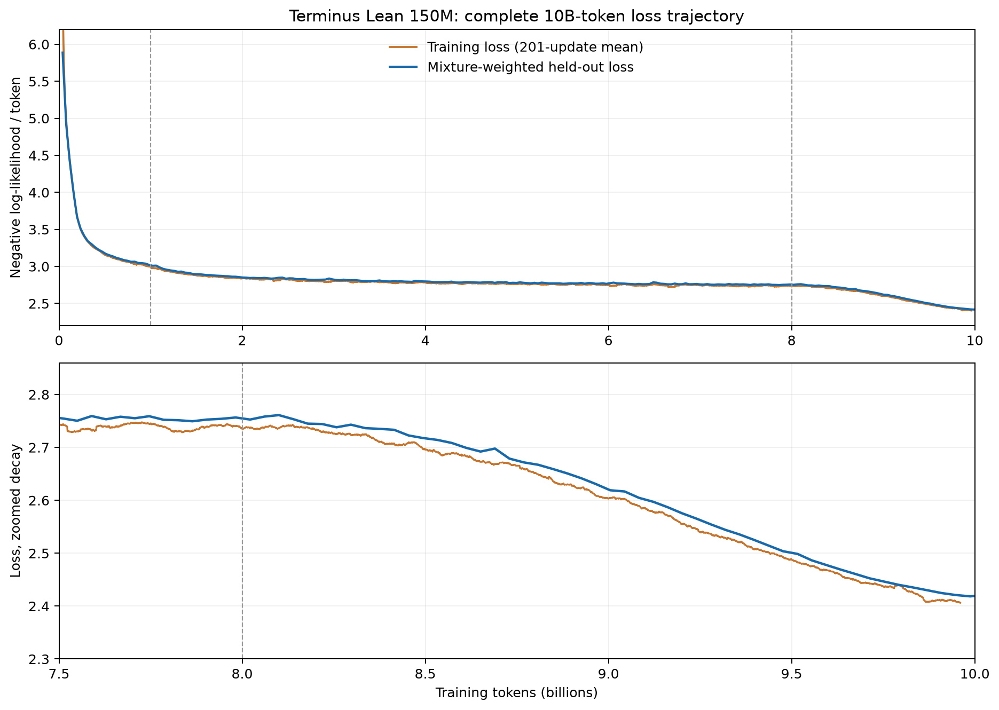
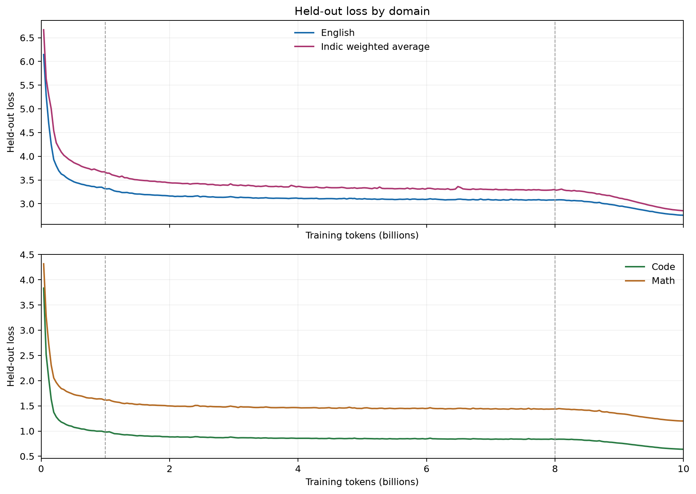
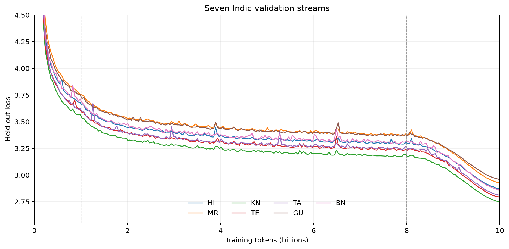
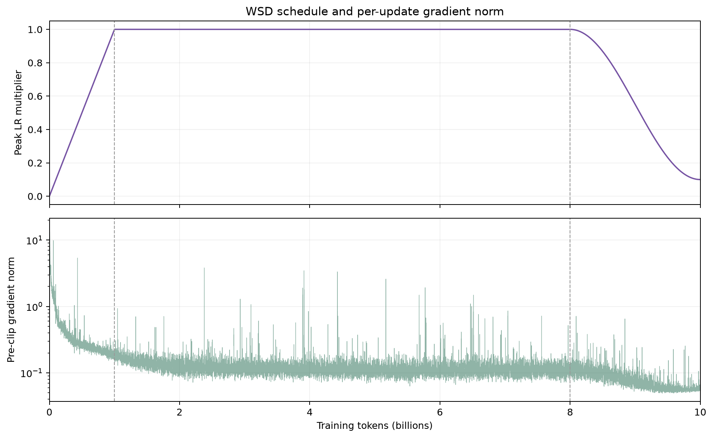
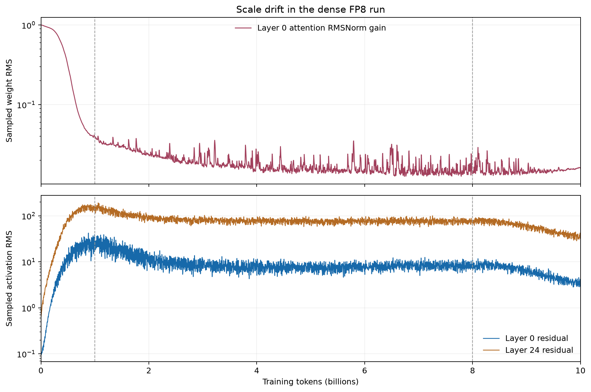
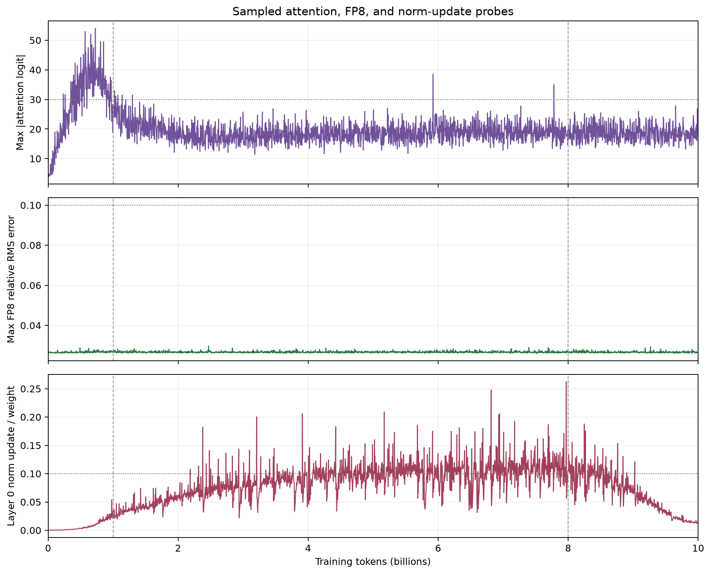
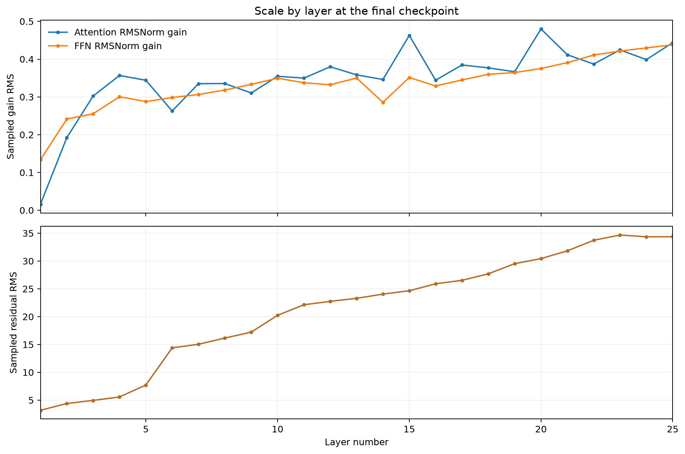

# Terminus Lean 150M dense-FP8 run: final checkpoint and log analysis

**Run:** `lean_dense_10b_20261001` · **Analyzed:** 2026-10-02 · **Training code:** `c95a951d5436489b8b0902e96b327adcaa11b524` · **Final checkpoint:** update 25,432, 9,999,998,976 tokens, SHA-256 `3d116e88048c93a0403ab2920b1680b066a9f29cbc07fa8ae1c2c67f2144684b`. Azure Blob verification covers 81 run files (37,880,410,132 bytes), including the final checkpoint, complete logs, audit, and inventory. The H100 VM is deallocated.

## Verdict

The run converged numerically and its held-out token loss improved across every tracked source. The final mixture-weighted validation loss is **2.4194** and English is **2.7597**. Most of the late improvement arrived during the 8B–10B learning-rate decay. That result supports the value of finishing the schedule, but this one run does not establish that the chosen learning rates, batch, or decay length are optimal.

The final checkpoint is **not yet a reliable task-completion model**. In a fixed 23-prompt greedy probe it answered some simple prompts, including a Q&A-form France-capital question and `2 + 2`, but failed `12 + 19`, the freezing point of water, several capital clozes, and sustained code completion. Many outputs became repetitive. This is a 146M-parameter base language model with no instruction tuning; held-out next-token loss is not a substitute for task accuracy.

One numerical signal merits a controlled follow-up before treating this checkpoint as an uncomplicated QAT starting point: the **first attention RMSNorm gain collapsed from RMS 1.0 to 0.0165**, while the sampled final-layer residual grew from RMS 0.61 near initialization to 34.37 at the end. Loss never diverged and the residual scale fell substantially during decay, so this is not proof of a failed run. It is an unusual learned scale regime, and the copied `norm_lr=0.01` is a plausible contributor that this run alone cannot identify causally.

## What ran and how loss was measured

The model has 146,423,680 trainable parameters, 25 layers, width 640, a 65,536-piece frozen tokenizer, four 512-token local-attention layers per global-attention layer, dense FP8 projection arithmetic with FP32 master weights, and Muon for projection matrices. It used BF16 residuals, main block RMSNorms, no SubLN, and no Q/K normalization. The run used one H100 NVL, microbatch 48, two gradient-accumulation steps, 4,096-token sequences, and a nominal **393,216 training tokens per optimizer update**. The last update was partial (122,880 tokens). The WSD schedule used 1B-token warmup, 7B stable tokens, and 2B cosine decay to 10% of peak learning rate. The peak projection, embedding, and normalization base learning rates were set to 0.01, with Muon matrix-specific scaling; normalization vectors were in the auxiliary AdamW group with no weight decay.

Each validation event scored **1,572,864 held-out tokens per source** for English, code, math, and seven Indic languages. The overall loss below is the source-loss mean weighted by the recorded training mixture: 50% English, 10% code, 10% math, and 30% Indic (4.2–4.3% per Indic language). It is not the unweighted average of the ten displayed losses. All losses are mean negative log-likelihood per tokenizer token. A low code loss does not imply code-task competence; domains have different predictability and the prompt test shows the distinction.

## Loss trajectory

| Training tokens | Update | Weighted validation | English | Indic weighted | Code | Math |
| ---: | ---: | ---: | ---: | ---: | ---: | ---: |
| 0.983B | 2,500 | 3.0214 | 3.3194 | 3.6726 | 0.9834 | 1.6162 |
| 5.000B | 12,716 | 2.7788 | 3.0977 | 3.3335 | 0.8481 | 1.4508 |
| 7.982B | 20,300 | 2.7566 | 3.0798 | 3.2978 | 0.8364 | 1.4372 |
| 9.005B | 22,900 | 2.6190 | 2.9477 | 3.1157 | 0.7606 | 1.3442 |
| 10.000B | 25,432 | **2.4194** | **2.7597** | **2.8525** | **0.6389** | **1.1989** |

The weighted loss fell 0.265 between the end of warmup and roughly 8B tokens, then **0.337 in the 2B-token decay**. English fell 0.320 during decay. Every Indic stream improved by 0.417–0.461 over that interval. The lowest recorded weighted validation was 2.41845 at update 25,400; the final value is only 0.00093 higher, well within the small variation visible in adjacent checks. There is no sustained late validation reversal.







The final per-source validation losses are:

| Source | Loss | Source | Loss |
| --- | ---: | --- | ---: |
| English | 2.7597 | Code | 0.6389 |
| Math | 1.1989 | Hindi | 2.8699 |
| Marathi | 2.9260 | Kannada | 2.7501 |
| Telugu | 2.7916 | Tamil | 2.8090 |
| Gujarati | 2.9592 | Bengali | 2.8593 |

## Fixed prompt test on the final checkpoint

I used the frozen tokenizer (SHA-256 `c53e0e95cd19e2954a8c7114c0a580eeb16698b153fdf84c5d80a7187d778d29`) and placed `<eod>` before each prompt to begin a packed-style document. Decoding was **greedy (`temperature=0`)**, capped at 48 new tokens, with `<eod>` as the stop token. None of the 23 completions emitted `<eod>` before the cap. The checkpoint was SHA-verified before loading. The appendix preserves the decoded text, with otherwise invisible trailing ASCII spaces shown as `␠`.

This probe ran on a **CPU reference**: each dense projection was quantized once to the run's blockwise FP8 E4M3 weight representation, activations used the reference FP8 quantizer, and the model used BF16 autocast with PyTorch SDPA attention. It preserves the saved weights, tokenizer, architecture, and major quantization choices, but does **not** execute H100 DeepGEMM, Triton fusion, or FA3. It is a qualitative check, not an official downstream score or a bit-exact native-GPU inference result. The repository's model/tokenizer files have not changed since the training commit.

Selected observations from the exact outputs in the appendix:

- Prompt format changes the result: `The capital of France is` continued incorrectly, while `Q: What is the capital of France?\nA:` answered **Paris** and then repeated the Q&A pair.
- `2 + 2 =` began with **4**, but `12 + 19 =` began with **19** and the worked-example prompt answered **20**, both wrong.
- `Water freezes at` produced **−18°C**. The Earth-orbit prompt started with **Sun**, then incorrectly claimed the Sun revolves around Earth.
- A factorial prompt began with the correct recursive line, but continued into invalid top-level Python. The `add` and `is_even` prompts produced docstring prose without a working function body within 48 tokens.
- Text was generated in all seven Indic languages, but capital questions were inconsistent and several outputs looped. Tamil began with Delhi, followed by repeated punctuation; Hindi named Mumbai as India's capital. Kannada and Gujarati produced text about Delhi without directly answering the cloze.

These are fixed, hand-selected examples, **not a statistically representative benchmark**. They demonstrate a gap between next-token prediction and reliable answers or executable code. Greedy decoding can exaggerate loops; a tuned sampler may improve prose but cannot make an incorrect factual answer correct by itself.

## Numerical and stability audit

The final audit confirmed 25,432 contiguous per-update training records, 257 validation events, 2,546 sampled stability-probe updates, and matching midpoint/final checkpoint receipts. It recorded **zero non-finite incidents**, **zero training-loss spikes above twice the preceding 20-update median**, and no non-finite values in any sampled probe. Direct inspection found no non-finite model tensor in the final checkpoint. The launch GPU suite passed 29 tests and the native preflight passed; those checks establish execution/numerical readiness, not downstream quality.

Gradient clipping occurred on 254 of 25,432 updates (1.0%): 238 during warmup, 16 during the stable phase, and **none during decay**. The 19 updates with a clipping coefficient below 0.1 were updates 1–19. Pre-clip gradient norm had median 0.113, 99th percentile 0.995, and maximum 16.05 early in training. This does not show a continuing gradient explosion.

Across every sampled FP8 projection input, relative reconstruction RMS error had median **2.43%**, 99th percentile **2.65%**, and maximum **2.97%**. No probe crossed the audit's 10% FP8-error cue; the maximum observed zero-code fraction was 0.45%. This is a sampled input-quantization measure, not a direct end-to-end native-versus-BF16 quality comparison.

The audit counted 3,169 investigation alerts: 2,185 sampled attention entropy values below 0.1, 270 sampled attention logits above 30, and 714 update-to-weight RMS ratios above 0.1. The high-logit alerts were concentrated in warmup (260 of 270) and absent during decay. The low-entropy cue persists, but its probe uses **the last query, five heads, and only the last 128 keys**; a single sharply focused head or that sampling rule can trigger it. It does not establish full-window attention collapse.

All 714 update-ratio alerts came from `layers.0.attn_norm.weight`. Its saved full-vector RMS is **0.01646**, versus 1.0 at initialization, and 46.7% of its final entries are negative. A small denominator makes an otherwise modest update look large: near 5B tokens its sampled weight RMS was 0.0170, update RMS 0.00178, and ratio 0.105. At the final update that ratio fell to 0.0132. Other layer norms remained larger; for example, the final layer's attention-norm gain RMS is about 0.445. The sampled layer-24 residual RMS rose from 0.61 initially to a maximum of 191, then fell to **34.37** by the end of decay. These values are finite and the loss improved, but the scale migration should be tested before assuming ternary QAT will behave normally from this checkpoint.









## Time, throughput, and recording integrity

Training ran from **October 1, 7:06 p.m. IST** to **October 2, 4:23 p.m. IST**, in three recorded invocations. The first was interrupted at update 12,339 / 4.852B tokens by the Azure shutdown schedule; the VM remained deallocated for about **8 hours 10 minutes** before the exact-resume checkpoint was used. The planned midpoint stop at update 12,716 / 5.000B tokens added about 38 seconds between invocations. The final training and verification receipts are complete, and the VM deallocated only after Blob size/MD5 verification.

The sum of the three **training-invocation wall times** is 13.11 hours, yielding **211,873 training tokens/s** including validation, checkpointing, and training-process overhead. Median logged per-update throughput after the initial 100 updates was **236,566 tokens/s**. The 10.4% difference is consistent with periodic evaluation, checkpoint I/O, and other pauses; it is not a measured kernel-only overhead attribution. Peak reported CUDA allocated memory was **84.37 GiB** and peak reserved memory **87.71 GiB**. These invocation times are not the entire Azure billing interval, which also includes VM preparation and finalization.

Validation was frequent: 257 events × 15,728,640 scored tokens per event = **4.04B held-out forward-pass tokens**. Those are not training tokens and do not imply the same FLOP cost as backpropagation. The recorded 100-update cadence was useful for diagnosing this pilot, but future cost-sensitive searches can test a lower cadence while preserving milestone and final evaluations.

## What this run does and does not establish

1. **Established:** the dense FP8 stack completed 10B tokens with a resumable, audited checkpoint; held-out loss improved in all ten sources; the final checkpoint is archived and the VM is deallocated.
2. **Strong signal:** finishing the 2B-token decay mattered greatly for this trial. A controlled shorter/longer decay or lower peak-LR comparison is still needed to choose a recipe.
3. **Concern to test:** first-layer norm-gain collapse, large residual scales, and persistent focused-attention cues occurred despite finite gradients and falling loss. A small paired continuation or rerun with lower **auxiliary norm LR**, keeping data and projection LR fixed, would test the most direct hypothesis. Compare held-out loss, gain/residual trajectories, and the same prompt set; do not infer causality from this single run.
4. **Not established:** broad downstream ability, production inference quality, task-aware ModelTunnelv2 transfer, or QAT conversion quality. The prompt suite is illustrative and the CPU reference is not native H100 inference. Formal held-out task evaluation and a QAT branch should use the verified final checkpoint and preserve their own receipts.

## Reproduction and source files

The raw verified run lives under Azure Blob `runs/terminus_lean_150m_10b_run_20261001/`. The final checkpoint is also in the S3 run mirror. Raw logs, checkpoint tensors, and corpora are intentionally **not committed** in this repository. To reproduce the figures after downloading the named Blob files into one run-root directory:

```bash
python -m pip install matplotlib numpy torch
python experiments/terminus_lean_150m_10b/analysis/analyze_final_run.py \
  --run-root /path/to/downloaded/run \
  --output-dir experiments/terminus_lean_150m_10b/analysis/figures
python experiments/terminus_lean_150m_10b/analysis/probe_final_checkpoint.py \
  --run-root /path/to/downloaded/run \
  --tokenizer tokenizer/tokenizer-65k.json \
  --output /path/to/prompt_results.json
```

The analysis consumed `dense/events.jsonl`, `dense/stability.jsonl`, `audit_final.json`, `views/manifest.dense.json`, `config.json`, `dense/run.json`, the final checkpoint/receipt, the frozen tokenizer, and launch/finalizer receipts. Numeric summaries used to draw the figures are in [figures/metrics.json](figures/metrics.json). Validation source exposure is specified by the manifest, while the event log does not record each training document's realized source identity. The stability probe samples the first microbatch on selected updates and cannot rule out unobserved brief events between samples.

## Appendix: all fixed prompt completions

Each completion below is the decoded greedy output from the SHA-verified final checkpoint, capped at 48 new tokens. Input prompts and output are kept separate; `␠` marks each trailing ASCII space.

### 1. France capital cloze (english_fact)

Prompt:
```text
The capital of France is
```

Completion (48 new tokens):
```text
 the capital of the United States. The United States is the largest country in the world. The United States is the largest country in the world. The United States is the largest country in the world. The United States is the largest country in
```

### 2. India capital cloze (english_fact)

Prompt:
```text
The capital of India is
```

Completion (48 new tokens):
```text
 known for its rich cultural heritage and stunning natural beauty. However, the country faces challenges in its quest for sustainable development. One of the most pressing concerns is the issue of land degradation. Land degradation is a major issue in India, and it
```

### 3. Earth orbit cloze (english_fact)

Prompt:
```text
The Earth revolves around the
```

Completion (48 new tokens):
```text
 Sun, and the Sun revolves around the Earth. The Earth revolves around the Sun, and the Earth revolves around the Sun. The Earth revolves around the Sun, and the Earth revolves around the Sun. The Earth rev
```

### 4. Freezing point cloze (english_fact)

Prompt:
```text
Water freezes at
```

Completion (48 new tokens):
```text
 -18°C, so the temperature of the water is -18°C. The temperature of the water is -18°C.

The temperature of the water is -18°C
```

### 5. France capital QA (english_qa)

Prompt:
```text
Q: What is the capital of France?
A:
```

Completion (48 new tokens):
```text
 The capital of France is Paris.
Q: What is the capital of France?
A: The capital of France is Paris.
Q: What is the capital of France?
A: The capital of France is Paris.

```

### 6. Week days QA (english_qa)

Prompt:
```text
Q: How many days are there in a week?
A:
```

Completion (48 new tokens):
```text
 There are 24 hours in a week.
Q: What is the difference between a day and a week?
A: A day is a time, while a week is a time.
Q: What is the difference between
```

### 7. Two plus two (math)

Prompt:
```text
2 + 2 =
```

Completion (48 new tokens):
```text
 4

2 + 2 = 4

2 + 2 = 4

2 + 2 = 4

2 + 2 = 4


```

### 8. Twelve plus nineteen (math)

Prompt:
```text
12 + 19 =
```

Completion (48 new tokens):
```text
 19

12 + 19 = 19

12 + 19 = 19

12 + 19 = 19

1
```

### 9. Square root (math)

Prompt:
```text
The square root of 81 is
```

Completion (48 new tokens):
```text
 approximately 1.4141.

The square root of 81 is approximately 1.4141.

The square root of 81 is approximately 1.4141.

```

### 10. Few-shot arithmetic (math)

Prompt:
```text
Question: What is 2 + 3?
Answer: 5

Question: What is 7 + 4?
Answer: 11

Question: What is 12 + 19?
Answer:
```

Completion (48 new tokens):
```text
 20

Question: What is 12 + 19?
Answer: 20

Question: What is 12 + 19?
Answer: 20

Question
```

### 11. Add function (code)

Prompt:
```text
def add(a, b):
␠␠␠␠
```

Completion (48 new tokens):
```text
"""
    Add two integers a and b to a list in-place.
    The function modifies the input list so that each element
    is replaced by the sum of the two numbers.
    The algorithm uses a stack to process the
```

### 12. Parity function (code)

Prompt:
```text
def is_even(n):
␠␠␠␠
```

Completion (48 new tokens):
```text
"""Return True if n is an even integer.
    The function validates that `n` is a non‑negative integer;
    if not, it raises a ValueError.
    >>> is_even(10): True
␠␠␠␠
```

### 13. Factorial continuation (code)

Prompt:
```text
def factorial(n):
    if n <= 1:
        return 1
␠␠␠␠
```

Completion (48 new tokens):
```text
else:
        return n * factorial(n - 1)

# Example usage:
if n == 1:
    return 1
else:
    return 1

# Return the factorial of␠
```

### 14. Story continuation (english_prose)

Prompt:
```text
Once upon a time, a small fox entered a forest and
```

Completion (48 new tokens):
```text
 started to explore its surroundings. It was curious about what it was doing and how it could help humans.

As it approached, the fox began to investigate its surroundings. It looked around and saw a small tree with branches and leaves.
```

### 15. Internet history (english_prose)

Prompt:
```text
The history of the Internet began with
```

Completion (48 new tokens):
```text
 the invention of the Internet in 1909. The first Internet was created by the United States government. The first Internet was created by the United States government. The first Internet was created by the United States government. The first Internet
```

### 16. India capital Hindi (hindi)

Prompt:
```text
भारत की राजधानी है
```

Completion (48 new tokens):
```text
मुंबई। मुंबई के अलावा देश के अन्य शहरों में भी लोग रहते हैं। मुंबई में कई तरह के होटल और रेस्टॉरेंट हैं। मुंबई में कई तरह के रेस्टॉरेंट हैं। मुंबई में कई तरह के रेस्टॉरेंट हैं। मुंबई
```

### 17. Maharashtra capital Hindi (hindi)

Prompt:
```text
भारत की राजधानी नई दिल्ली है। महाराष्ट्र की राजधानी
```

Completion (48 new tokens):
```text
है। महाराष्ट्र के मुख्यमंत्री एकनाथ शिंदे ने 2014 में महाराष्ट्र के मुख्यमंत्री के रूप में शपथ ली थी।
 महाराष्ट्र के मुख्यमंत्री एकनाथ शिंदे ने 2014 में महाराष्ट्र के मुख्यमंत्री के रूप में शपथ ली थी।
␠
```

### 18. Maharashtra capital Marathi (marathi)

Prompt:
```text
महाराष्ट्राची राजधानी
```

Completion (48 new tokens):
```text
मुंबईत आज (19 जून) दुपारी 12. 30 वाजता राष्ट्रवादी काँग्रेसचे अध्यक्ष शरद पवार यांची मुंबईत जाहीर सभा होणार आहे. या सभेत राष्ट्रवादी काँग्रेसचे नेते आणि खासदार छगन
```

### 19. Bangladesh capital Bengali (bengali)

Prompt:
```text
বাংলাদেশের রাজধানী
```

Completion (48 new tokens):
```text
 ঢাকায় অবস্থিত বাংলাদেশ হাইকমিশন অব ইন্ডাস্ট্রিজ (বিএইচআইসি) এর উদ্যোগে 'বাংলাদেশের হাইকমিশন অব ইন্ডাস্ট্রিজ' (বি
```

### 20. India capital Kannada (kannada)

Prompt:
```text
ಭಾರತದ ರಾಜಧಾನಿ
```

Completion (48 new tokens):
```text
 ದೆಹಲಿಯಲ್ಲಿ ದೆಹಲಿ ದೆಹಲಿ ಎಂಬ ಹೆಸರಿನಿಂದ ಕರೆಯಲ್ಪಡುವ ದೆಹಲಿ ದೆಹಲಿ ಎಂಬ ಹೆಸರಿನಿಂದ ಕರೆಯಲ್ಪಡುವ ದೆಹಲಿ ದೆಹಲಿ ಎಂಬ ಹೆಸರಿನಿಂದ ಕರೆಯಲ್ಪಡುವ ದೆಹಲಿ ದೆಹ
```

### 21. India capital Gujarati (gujarati)

Prompt:
```text
ભારતની રાજધાની
```

Completion (48 new tokens):
```text
દિલ્હીમાં એક ચોંકાવનારો કિસ્સો સામે આવ્યો છે. અહીં એક વ્યક્તિએ પોતાના ઘરેથી 1000 રૂપિયા લીધા અને પછી તે પૈસા પરત નહી કરે. આ વ્યક્તિએ પોતાના ઘરેથી 10
```

### 22. India capital Tamil (tamil)

Prompt:
```text
இந்தியாவின் தலைநகரம்
```

Completion (48 new tokens):
```text
டெல்லி. . . . . . . . . . . . . . . . . . . . . . . . . . . . . . . . . . . . . . . . . . . . . .
```

### 23. India capital Telugu (telugu)

Prompt:
```text
భారతదేశ రాజధాని
```

Completion (48 new tokens):
```text
 ఢిల్లీలో ఢిల్లీ మెట్రోపాలిటన్ డెవలప్మెంట్ అథారిటీ (డీఎండీఏ) ఢిల్లీ మెట్రోపాలిటన్ డెవలప్మెంట్ అథారిటీ (డీఎండీఏ)␠
```
