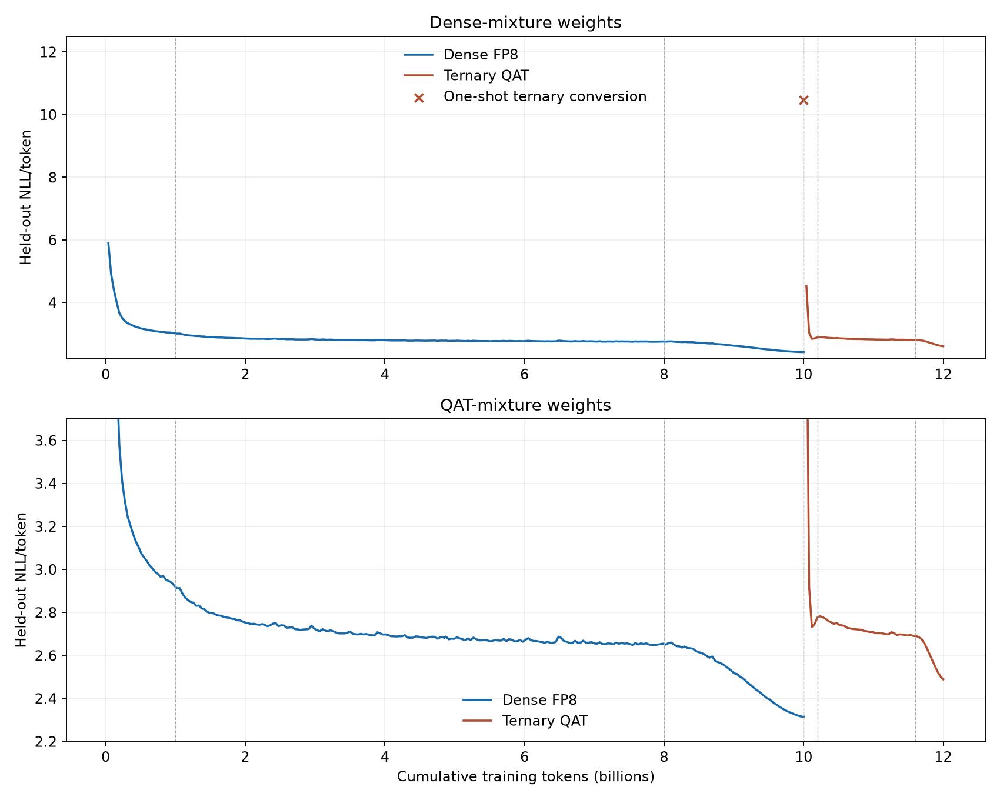
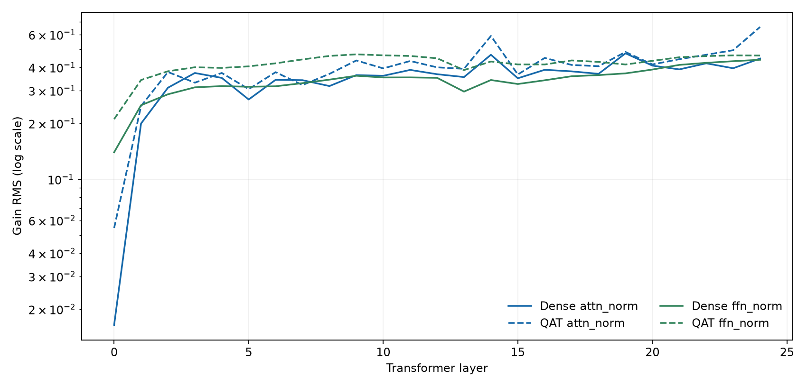
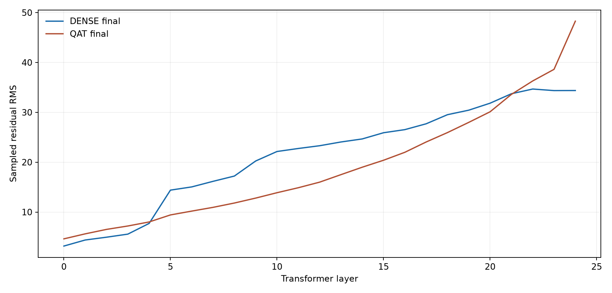
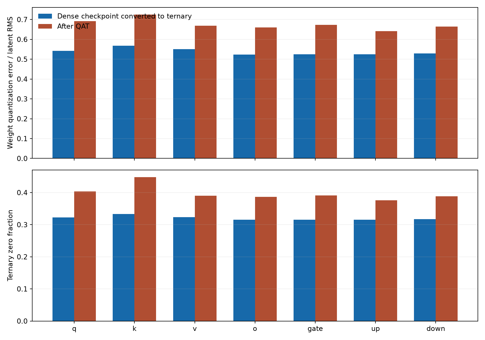

# Terminus Lean 150M: combined dense FP8 and ternary QAT review

**Analysis report — 5 October 2026.** This report evaluates the completed 10B-token dense-FP8 run and its 2B-token ternary continuation. It is an audit of **one** architecture, data recipe, optimizer setting, and seed. It is not a hyperparameter optimum or a prediction of 1.5B-model quality.

**Main findings:** execution and archival completed without non-finite incidents. The first attention norm and residual scale changed markedly during dense warmup; ternary conversion caused a large immediate loss increase, and the final QAT checkpoint remained worse than the dense checkpoint on every tracked held-out source. The existing 1.5B configuration differs from the tested Lean architecture in several ways. No main-run decision is inferred from these observations.

## 1. Evidence and scope

The dense checkpoint SHA-256 is `3d116e88048c93a0403ab2920b1680b066a9f29cbc07fa8ae1c2c67f2144684b`; the final QAT checkpoint SHA-256 is `ceee823262d11e914eb63d6a396c3df90fb47e5dd9301f7db0f8add0a468c29f`. Both 1,339,642,411-byte files were downloaded from the verified S3 run mirrors, rehashed locally, and analyzed with [analyze_combined_runs.py](analyze_combined_runs.py). Its [machine-readable metrics](combined_metrics.json) include **every trainable parameter**: seven logical projection groups in each of 25 layers, both main RMSNorm vectors in each layer, the final RMSNorm, and the tied embedding/output matrix. The counts reconcile exactly to 146,423,680. The script's ternary conversion was checked for exact agreement with the production Torch quantizer on three aligned shapes.

The dense stage completed 25,432 updates and 9,999,998,976 training tokens; QAT completed 5,087 updates and 1,999,998,976 tokens. All final checkpoint and log files were archived to S3 and Azure Blob, with final verification receipts; the VM deallocated. The dense stage was interrupted by an Azure shutdown and resumed exactly. The QAT stage finished in one invocation. The data view validates 897 packed shards and records fresh per-source offsets, so QAT did not reuse the dense-stage prefix within a source.

The training objective is ordinary teacher-forced **next-token cross-entropy** on pretokenized, packed 4,096-token streams, with `<eod>` (token id 4) between documents. It has no instruction, task-answer, or auxiliary loss in these two runs. A single H100 used microbatch 48 and two accumulation steps, giving 393,216 nominal training tokens per optimizer update; the final update in each stage was partial as recorded. Held-out loss is mean next-token negative log-likelihood **per frozen tokenizer token**, with 1,572,864 scored tokens for each of English, code, math, and seven Indic streams at each validation point. The same held-out source shards and tokenizer are used across the stages. Overall weighted losses must use the **same** mixture for both checkpoints; the training mixture changed at QAT. The evaluation does not measure instruction following, code execution, reasoning accuracy, deployment latency, or robustness across seeds. The previous [dense prompt probe](../../terminus_lean_150m_10b/analysis/FINAL_RUN_ANALYSIS.md) found several basic task failures despite improving loss; no equivalent QAT task suite has been completed.

## 2. Model and optimizer actually tested

| Component | Tested setting |
|---|---|
| Network | 25-layer decoder, width 640, FFN width 1,664, 65,536-piece tied input/output vocabulary |
| Attention | Five query heads, one KV head, head dimension 128; four 512-token local layers per one full-context global layer; context 4,096 |
| Normalization | Pre-attention and pre-FFN channel RMSNorm plus final RMSNorm; no SubLN and no Q/K RMSNorm |
| Residual and arithmetic | BF16 residual stream; FP32 latent projection weights; FP8 E4M3 projection operands and activations; DeepGEMM forward/dgrad/wgrad, FA3 attention, fused pointwise/loss path |
| Dense projection mode | Blockwise 128×128 FP8 weights with absmax scaling, no ternarization |
| QAT projection mode | All 104.448M projection weights represented as scaled `{-1,0,+1}` codes with 128×128 mean-absolute scale; FP8 activations retained |
| Optimizer | 100 physical Muon matrix groups, one auxiliary AdamW group for the tied embedding/output matrix, one auxiliary AdamW group for 51 normalization vectors; Q/K/V and gate/up have separate *logical* Muon orthogonalizations inside fused matrices but share their physical group's learning rate |

The 100 Muon matrices contain **104,448,000 parameters (71.33%)**. The tied embedding/output matrix contains **41,943,040 (28.64%)** and remains unquantized. All RMSNorm vectors together contain **32,640 (0.022%)**. The small proxy is therefore much more embedding-heavy than a 1.5B model with the same 65K vocabulary. A width-transfer rule cannot be validated from one width.

The dense peak base learning rates were 0.01 for Muon, embedding AdamW, and norm AdamW; QAT halved each to 0.005. Muon's implemented shape scale makes the *saved peak group rates* 0.050596 for the width-640 input matrices and 0.081584 for the down projections in dense, halved in QAT; these numbers are not directly comparable to AdamW's elementwise LR because Muon normalizes updates. Both phases used weight decay 0.1 on projections/embedding and **zero** weight decay on norms. QAT carried the trained weights, optimizer moments, and RNG, while resetting the QAT phase's update counter and data cursor to a checked fresh-source view.

## 3. Dense FP8: segment-by-segment behavior

| Dense phase | Tokens | Updates | Weighted held-out loss at phase end | Gradient clips | What happened |
|---|---:|---:|---:|---:|---|
| Warmup | 0–1B | 2,543 | 3.021 at 0.983B | 238 | Rapid learning, but most of the dense run's clipping and the first-layer norm collapse occurred here. |
| Stable | 1–8B | 17,802 | 2.757 at 7.982B | 16 | Slow improvement: about 0.265 loss units after warmup. Large residual scales persisted. |
| Decay | 8–10B | 5,087 | **2.419** | 0 | Loss improved by about 0.337; English fell by 0.320. No late validation reversal was recorded. |

The first validation at 39.3M tokens was 5.888 under the dense training mixture. At 5.000B it was 2.779, and at 9.005B it was 2.619. The final English/code/math losses were **2.7597 / 0.6389 / 1.1989**. All seven Indic losses improved during training. The 10B checkpoint is numerically valid, but the substantial gain during the final decay means its LR schedule is not established as optimal.

The first attention norm gain fell below sampled RMS 0.5 at 0.421B tokens, below 0.1 at 0.653B, and below 0.05 at 0.818B. At the final checkpoint its **full 640-coordinate RMS was 0.01646**, with 77.2% of coordinates below absolute value 0.01 and 46.7% negative. The final-layer residual probe exceeded RMS 100 by 0.531B, peaked at 191 at update 2,700, and settled to 34.37 by the finish. These two trajectories developed *during the first billion tokens*, so a corrective from-scratch pilot can detect them without repeating all 10B tokens. They are not, by themselves, proof that the norm LR caused the behavior; a learned suppression of an unhelpful attention branch is also possible.

The active dense training invocations took **13.11 H100 hours** for 10B training tokens, or 211.9K training tokens/s including validation/checkpoint overhead while the process ran. Median logged per-update speed was roughly 236K tokens/s during the long stable phase. An approximately 8-hour deallocated interval between invocations must not be counted as GPU training time. Dense peak CUDA allocated/reserved memory was **84.37/87.71 GiB**.

## 4. Ternary QAT: conversion, warmup, stable, decay

The conversion simultaneously changed all 104.448M effective projection weights. The chosen mean-absolute block scale and round-to-nearest ternary rule produced **31.7% zero codes** on the dense checkpoint and a **52.9% weight reconstruction error relative to latent weight RMS** across the projection matrices. These are direct checkpoint measurements. They explain why one-shot conversion is a major functional perturbation, but weight reconstruction error is not a substitute for loss.

Before the first QAT optimizer update, the common held-out sources gave English **10.195**, code **9.549**, math **9.224**, and QAT-mixture-weighted loss **10.517**. That spike is conversion shock, not a training divergence. It recovered quickly: the QAT-mixture validation was 4.436 after 39M QAT tokens, 2.776 after 197M, 2.690 near 1.6B, and **2.489** at 2.0B.

| QAT phase | QAT tokens | Updates | QAT-mixture held-out loss at phase end | Gradient clips | Interpretation |
|---|---:|---:|---:|---:|---|
| Re-warmup | 0–0.2B | 508 | 2.776 at 0.197B | 116 | Recovers most of the conversion shock. All clipping was in the first 122 updates; pre-clip norm peaked at 21.0. |
| Stable LR | 0.2–1.6B | 3,561 | 2.690 at 1.573B | 0 | Only about 0.086 improvement over 1.4B tokens. English worsened slightly from 3.194 at 0.118B to 3.248 at 0.197B as the LR reached peak; this is a warning, not proof the peak is too high. |
| Decay | 1.6–2.0B | 1,018 | **2.489** | 0 | Improved about 0.201 in 0.4B tokens. The last validation points were still descending, so the chosen QAT duration/decay is not shown to be optimal. |

The final QAT English/code/math losses were **2.9857 / 0.7208 / 1.3165**. The QAT training process took about **2.56 H100 hours**, or 217.4K all-in training tokens/s from its start to completion; median logged update throughput was about 248K tokens/s. That small measured difference from dense is not a causal kernel speedup claim because the stage lengths, validation, compilation, and checkpoint schedules differ. QAT peak allocated/reserved memory was **84.37/87.19 GiB**.

The QAT stage used **2B tokens**, equal to the dense stage's **2B-token decay**, not twice that decay. Applying the [MiniCPM4 paper's](../../../papers/minicpm4_2506.07900.pdf) “twice decay” wording mechanically to this dense schedule would give 4B, but the paper does not establish 4B as Terminus's optimum. Its 5M-model pilot, 150M verification, and released BitCPM4 settings have different training lengths, architectures, data, and an activation-precision policy. BitCPM4's paper reports final outcomes and says LR re-warmup is important; it does not show that its conversion suffered no immediate loss spike. Our FP8 activations were already present in the dense phase, so the one-step weight-mode switch is the primary known change at QAT token zero.

## 5. Matched quality comparison and data caveats

The QAT source mix changed from **50% English / 10% code / 10% math / 30% Indic** to **37% / 13% / 13% / 37%**, because only about 748M unused English tokens remained in the prepared corpus. It consumed 740M new English tokens, 260M each of code/math, and about 740M total Indic tokens from fresh source tails. A further sequential QAT continuation cannot keep 37% fresh English with this dataset without preparing more English. This is a **data readiness blocker** for testing longer QAT on the same model.

The table below evaluates *both checkpoints under the same weighting*, avoiding the misleading comparison between the dense run's 2.419 and QAT's 2.489 from different mixtures.

| Fixed validation weighting | Dense at 10B | QAT at 10B+2B | QAT minus dense |
|---|---:|---:|---:|
| Original dense mixture | **2.4194** | 2.6042 | **+0.1848** |
| QAT training mixture | **2.3154** | 2.4889 | **+0.1735** |

Every tracked source worsened after QAT, despite two billion additional training tokens. This is a real quality gap on the held-out next-token objective, though its cause cannot be assigned solely to ternarization because the QAT stage also changed LR schedule, training mixture, and source position. A same-data, same-LR **dense continuation control** has not been run.

The domain trajectories show that the conversion shock was broad, the stable QAT phase barely moved the losses, and the QAT decay improved every domain:

| Checkpoint | English | Code | Math | Seven-Indic simple mean |
|---|---:|---:|---:|---:|
| Dense, 0.983B | 3.3194 | 0.9834 | 1.6162 | 3.6722 |
| Dense, 7.982B | 3.0798 | 0.8364 | 1.4372 | 3.2974 |
| Dense, 10.000B | **2.7597** | **0.6389** | **1.1989** | **2.8521** |
| Immediate ternary conversion, QAT 0 | 10.1949 | 9.5486 | 9.2236 | 11.6354 |
| QAT, 0.197B | 3.2477 | 0.9098 | 1.5270 | 3.3991 |
| QAT, 1.612B | 3.1844 | 0.8379 | 1.4541 | 3.2813 |
| QAT, 2.000B | **2.9857** | **0.7208** | **1.3165** | **3.0251** |

This Indic column is an unweighted average for readability; the aggregate loss table above uses the exact versioned source weights.

| Source | Dense | QAT | Delta |
|---|---:|---:|---:|
| English | 2.7597 | 2.9857 | +0.2260 |
| Code | 0.6389 | 0.7208 | +0.0819 |
| Math | 1.1989 | 1.3165 | +0.1176 |
| Hindi | 2.8699 | 3.0459 | +0.1761 |
| Marathi | 2.9260 | 3.1042 | +0.1782 |
| Kannada | 2.7501 | 2.9107 | +0.1606 |
| Telugu | 2.7916 | 2.9716 | +0.1800 |
| Tamil | 2.8090 | 2.9862 | +0.1772 |
| Gujarati | 2.9592 | 3.1235 | +0.1643 |
| Bengali | 2.8593 | 3.0338 | +0.1744 |

Code and math have lower absolute per-token loss because their validation distributions differ from natural prose. Those absolute numbers must not be read as proof that the model solves code or math tasks. All training and validation uses the same frozen 65K tokenizer (SHA-256 `c53e0e95cd19e2954a8c7114c0a580eeb16698b153fdf84c5d80a7187d778d29`); QAT did not retokenize. Source-wise deltas are therefore directly interpretable as changes on those validation sets.

## 6. Numerical stability and representation signals

| Signal | Dense FP8 | Ternary QAT | Reading |
|---|---:|---:|---|
| Completed updates / non-finite incidents | 25,432 / 0 | 5,087 / 0 | Execution was numerically stable. |
| Training-loss spikes >2× preceding 20-update median | 0 | 0 | No sustained step-level blow-up. |
| Gradient-clipped updates | 254 (1.0%) | 116 (2.3%) | Dense clips mainly in warmup; QAT clips exclusively by update 122. |
| FP8 input relative reconstruction RMS error, median / maximum | 2.43% / 2.97% | 2.51% / 3.10% | The activation FP8 path is not showing a gross quantizer failure. |
| Non-finite sampled probe values | 0 | 0 | Across 2,546 dense and 510 QAT probe records. |
| Maximum sampled attention logit | 54 | 27 | Dense high-logit alerts were mostly early; QAT had no sampled logit above 30. |
| Low sampled attention entropy readings (<0.1) | 2,318 / 63,650 | 257 / 12,750 | QAT has fewer by fraction, but the probe covers the last query and last 128 keys, not whole attention. The dense audit's 2,185 *alerts* is lower because high-logit alerts take precedence on the same probe. |
| Last-layer residual RMS at final probe | 34.37 | 48.28 | QAT ends in a larger BF16 residual-scale regime. |

The first attention norm is the clearest outlier. Its full-vector RMS is **0.0165 dense → 0.0546 QAT**, while the other 24 attention norms range from 0.199–0.475 dense and 0.247–0.658 QAT. At QAT finish, a *single coordinate accounts for 75.3% of that first norm's squared magnitude*. The sampled first-layer attention output RMS is only **0.076** in both final checkpoints, versus first-layer FFN output RMS **3.18 dense / 4.62 QAT**. This suggests that the first attention branch contributes little by amplitude, but a direct held-out ablation is required before declaring it removable.

At the other end, the sampled **last-layer attention output RMS rose from 3.09 to 20.76** after QAT, while final residual RMS rose from 34.37 to 48.28. The largest QAT residual probe was 56.07. A model can have finite loss while using such compensation; the concern is that BF16 residual precision and scale transfer may become sensitive at larger width/depth. Recheck on multiple fixed validation batches and, if this repeats, compare an FP32 residual control against BF16 at matched data/cost.

## 7. Every trainable parameter group

The following table splits the fused QKV tensor into **Q, K, V**, and fused gate/up into **gate, up**, so it describes each logical trainable matrix family rather than hiding small KV groups inside aggregate tensors. “Ternary error” is RMS distance between the FP32 master and its ternary representation divided by the master's RMS. It is an *offline weight diagnostic*, not a measure of language-model loss. All 25 layer-specific measurements are in [combined_metrics.json](combined_metrics.json).

| Group | Parameters | Master RMS, dense → QAT | Ternary error, dense → QAT | Zero codes, dense → QAT |
|---|---:|---:|---:|---:|
| **Q projection** | 10.240M | 0.114 → 0.172 | 0.542 → **0.692** | 32.3% → 40.3% |
| **K projection** | 2.048M | 0.139 → 0.265 | 0.568 → **0.725** | 33.4% → **44.8%** |
| **V projection** | 2.048M | 0.163 → 0.336 | 0.551 → 0.669 | 32.3% → 39.0% |
| **Attention output O** | 10.240M | 0.129 → 0.214 | 0.523 → 0.660 | 31.6% → 38.7% |
| **SwiGLU gate** | 26.624M | 0.137 → 0.213 | 0.525 → 0.673 | 31.5% → 39.1% |
| **SwiGLU up** | 26.624M | 0.141 → 0.223 | 0.525 → 0.641 | 31.5% → 37.6% |
| **FFN down** | 26.624M | 0.139 → 0.234 | 0.530 → 0.664 | 31.7% → 38.8% |
| **Tied embedding/output** | **41.943M** | 0.1178 → 0.1264 | — | — |
| **25 attention RMSNorm gains** | 16,000 | Layer 0: 0.0165 → 0.0546 | — | — |
| **25 FFN RMSNorm gains** | 16,000 | Layer 0: 0.1395 → 0.2104 | — | — |
| **Final RMSNorm gain** | 640 | 0.7969 → 0.6569 | — | — |

The group-specific reading is as follows:

- **Q:** Its effective-weight change versus the dense master is the largest among projection groups (0.926 relative RMS). Test Q-specific scale/LR and trained-checkpoint attention parity; weight distance alone does not establish quality impact.
- **K:** It has the highest QAT error and zero-code fraction, including layer outliers. Keeping only K dense is a cheap *diagnostic upper bound*; then test ternary scale/threshold and per-slice LR.
- **V:** Its master RMS more than doubled, and its effective ternary RMS is 1.114× the dense master's RMS. Test V-specific scale/LR and the resulting attention outputs.
- **O:** It controls the residual addition from attention. Measure whether late-layer amplification originates in O or in upstream attention.
- **Gate and up:** Together they hold 36.4% of all parameters. Compare scale/threshold calibration and pre/post-activation distributions before adding normalization.
- **Down:** This projection connects the FFN intermediate to the residual stream. Monitor branch-output/residual ratio and clipping under each candidate.
- **Tied embedding/output:** It moved by 0.692 relative RMS from dense to QAT, with cosine 0.779, despite remaining unquantized. Isolate its AdamW LR and determine whether drift compensates ternary blocks or harms language coverage.
- **Attention and FFN RMSNorm gains:** Their tiny parameter count belies high functional leverage. Test norm LR and the first-attention functional ablation. Other FFN gains also remain far below initialization 1.0; examine them with residual scales.
- **Final RMSNorm:** Its gain controls tied-output logits. Separate its LR and functional tests from the main block norms.

Across all projection weights, the ternary reconstruction error is **0.529** immediately after converting the dense checkpoint and **0.664** relative to the QAT final *latent* weights; zero-code fraction rises from **31.7% to 38.8%**. This **does not** prove QAT made the model worse during training: QAT optimizes token loss through a straight-through gradient, not the Euclidean distance between latent and effective weights. It does show that the latent distribution moves *away* from an L2-friendly ternary representation while the model recovers functionally. Before redesigning the quantizer, compare actual held-out loss from alternative scale/threshold rules and short QAT branches.

The seven matrix groups in each of 25 layers account for 104.448M parameters. The embedding and all norm vectors account for the remaining 41.976M; there are no unexamined trainable groups. Per-layer detail is preserved in the JSON. A compact outlier view follows:

| Layer | Attn norm RMS dense → QAT | FFN norm RMS dense → QAT | Sampled residual RMS dense → QAT | Highest QAT ternary error |
|---:|---:|---:|---:|---|
| 0 | 0.016 → 0.055 | 0.140 → 0.210 | 3.2 → 4.6 | K: 0.787 |
| 1 | 0.199 → 0.247 | 0.250 → 0.341 | 4.4 → 5.6 | V: 0.664 |
| 2 | 0.310 → 0.377 | 0.286 → 0.381 | 5.0 → 6.5 | K: 0.738 |
| 3 | 0.373 → 0.330 | 0.312 → 0.400 | 5.6 → 7.2 | V: 0.673 |
| 4 (global) | 0.351 → 0.373 | 0.317 → 0.397 | 7.7 → 8.0 | V: 0.652 |
| 5 | 0.268 → 0.305 | 0.314 → 0.404 | 14.4 → 9.4 | V: 0.645 |
| 6 | 0.342 → 0.376 | 0.316 → 0.420 | 15.0 → 10.2 | K: 0.666 |
| 7 | 0.341 → 0.321 | 0.329 → 0.441 | 16.2 → 10.9 | Down: 0.643 |
| 8 | 0.317 → 0.368 | 0.343 → 0.460 | 17.2 → 11.8 | Down: 0.654 |
| 9 (global) | 0.363 → 0.435 | 0.360 → 0.469 | 20.2 → 12.8 | K: 0.690 |
| 10 | 0.360 → 0.394 | 0.352 → 0.464 | 22.1 → 13.9 | Gate: 0.668 |
| 11 | 0.387 → 0.432 | 0.353 → 0.460 | 22.7 → 14.9 | K: 0.714 |
| 12 | 0.367 → 0.399 | 0.351 → 0.447 | 23.3 → 16.0 | K: 0.694 |
| 13 | 0.354 → 0.392 | 0.296 → 0.386 | 24.1 → 17.5 | K: 0.705 |
| 14 (global) | 0.467 → 0.589 | 0.341 → 0.430 | 24.7 → 19.0 | K: **0.832** |
| 15 | 0.349 → 0.366 | 0.325 → 0.414 | 25.9 → 20.4 | K: 0.693 |
| 16 | 0.388 → 0.449 | 0.340 → 0.414 | 26.5 → 22.0 | K: 0.789 |
| 17 | 0.380 → 0.412 | 0.358 → 0.435 | 27.7 → 24.1 | K: 0.766 |
| 18 | 0.369 → 0.405 | 0.363 → 0.427 | 29.5 → 25.9 | K: 0.732 |
| 19 (global) | 0.475 → 0.483 | 0.371 → 0.414 | 30.4 → 28.0 | K: 0.817 |
| 20 | 0.408 → 0.414 | 0.389 → 0.433 | 31.8 → 30.1 | K: 0.767 |
| 21 | 0.389 → 0.442 | 0.412 → 0.453 | 33.7 → 33.6 | K: 0.702 |
| 22 | 0.420 → 0.467 | 0.423 → 0.459 | 34.7 → 36.3 | K: 0.753 |
| 23 | 0.395 → 0.494 | 0.431 → 0.463 | 34.4 → 38.6 | K: 0.785 |
| 24 (global) | 0.446 → 0.658 | 0.439 → 0.462 | 34.4 → **48.3** | K: 0.751 |

The sample residual values are measured on one monitored training microbatch at each probe; they are not population statistics. The full checkpoint vector norms and matrix quantization statistics cover **all** saved coordinates.

## 8. Differences between the current 1.5B file and the tested Lean model

The existing [25-layer, width-2304 config](../../../configs/terminus_25l_2304d_64k_h100.json) is a historical candidate, not an explicit enlargement of the tested Lean architecture. Its omitted fields inherit model defaults. It specifies a **1,024-token** local window rather than 512, **18 query / 6 KV heads** (3:1 rather than 5:1 GQA), and inherits **SubLN enabled, unit Q/K normalization, and ternary weight mode** unless overridden. The pilot explicitly used no SubLN, no Q/K norm, dense weights first, then ternary. The file also uses different optimizer rates. A result from that configuration would combine changes in width, architecture, and training mode, so it would not isolate width transfer.

At width 2,304, 25 layers, FFN 5,760, and a 65K tied vocabulary, an otherwise Lean model would be about **1.500B parameters** and the embedding would fall from 28.64% to about 10% of parameters. The tested width-640/5:1 attention geometry cannot be preserved exactly with 18 query heads and six KV heads. Attention geometry, local window, normalization, optimizer policy, transition policy, and data horizon are therefore distinct variables in any width comparison.

## 9. Experiments that would resolve the open questions

These are possible controlled comparisons for the measured anomalies. Their order is an analysis sequence and does not establish an optimum.

1. **Trained-checkpoint arithmetic parity.** On H100, evaluate the *same packed held-out batches* with native DeepGEMM/FA3 and Torch/BF16-reference quantization for both saved checkpoints. Check projection forward outputs and gradients for Q, K, V, O, gate, up, and down using their trained weight distributions. Native preflight passed, but random-weight preflight alone does not answer the trained-checkpoint quality question.

2. **First-layer norm and dense-stage scale migration.** Run paired width-640 starts with identical seed/data: existing `norm_lr=0.01` versus approximately 0.001 and 0.0003, initially for 0.8–1B tokens. Keep projection/embedding LR and data fixed. Measure held-out loss, first-layer attention-output ablation, every norm gain, residual RMS, and gradient clips. Do not enforce a norm threshold by fiat: require better function and fewer pathologies.

3. **Separate embedding/head and final-norm LR.** On the best norm candidate, compare tied-embedding AdamW LR and final-norm LR separately. The embedding is 28.64% of this proxy and moved 0.692 relative RMS in QAT without being quantized. A short frozen-embedding QAT branch is diagnostic only; discard it if it hurts.

4. **Isolate the ternary quality tax.** From the *same* dense checkpoint, source tails, batch, optimizer-state policy, validation sets, and schedule, run a **dense continuation control**. Compare it with ternary QAT at matched additional tokens and compute. Without this control, the +0.174 QAT-mixture gap cannot be attributed to ternary weights.

5. **Ternary conversion and LR.** Compare short complete WSD QAT branches with peak rates below 0.005 and a different re-warmup/decay allocation. Run each candidate through its own decay before ranking; the baseline's stable phase barely improved, and its short decay did most of the work. Score a calibrated scale/threshold candidate on initial held-out loss *and* after matched QAT, not on raw weight L2 alone.

6. **Logical projection sensitivity.** Keep only Q, K, V, O, gate, up, or down dense while all other groups are ternary to estimate each group's quality cost. K is only 2.048M parameters and has the worst current QAT zero/error fraction. For any sensitive group, test a native-compatible scale/threshold or logical Muon LR adjustment. Preserve FP8 activations and fused compute where possible.

7. **Residual precision and attention geometry.** On the shortlisted recipe, compare BF16 and FP32 residual streams at matched tokens and measured throughput; examine whether late-layer amplification predicts quality loss. Independently test local window 512 versus nearby alternatives and the final GQA ratio. Keep architecture and optimizer changes separate.

8. **Data and actual tasks.** Prepare enough fresh, deduplicated English to support longer QAT or declare a controlled reuse policy. Recheck code indentation and math/Indic source quality. Evaluate matched English and all seven Indic held-out tasks, code execution, math answer accuracy, and conditional reference loss with contamination controls. Held-out token NLL is necessary but insufficient for “best model.”

9. **Scale transfer.** A short wider-model bridge with explicit Muon-width LR rules and an explicit Lean config would measure whether candidate rankings and stability transfer. The 150M result alone cannot validate the 1.5B rates or changed embedding/attention geometry.

At the observed all-in 150M rate, one additional **1B-token** dense pilot is roughly 1.3 H100 training hours before setup/compilation variance; one **0.4B-token** QAT pilot is roughly 0.5 hour. Changes to residual precision, batch, evaluation cadence, or kernels would need re-timing. The dense run scored 4.04B forward-only validation tokens, and QAT scored another 0.80B.

## 10. What is established and what remains unmeasured

**Established:** the tokenizer and packed-data contract worked in these runs; the native FP8 dense and ternary stacks ran on H100; checkpoint resume, per-source loss and stability logging, archival, and deallocation worked. The 150M system completed 12B combined training tokens without non-finite incidents.

**Unmeasured:** the optimum large-Lean architecture, width-transferred optimizer rates, dense/QAT token split, and downstream QAT task quality. The last QAT decay point was still improving, all ten domains lagged the dense parent, one attention norm and the late residual stream were scale outliers, and no matched dense continuation or QAT task evaluation has been run. The existing 1.5B config changes several architectural choices without a corresponding bridge measurement.

The open comparisons are trained-checkpoint native/reference parity; first-layer and residual behavior under alternate dense recipes; QAT versus a same-data dense continuation; per-language and downstream tasks; data availability for the chosen horizon; and transfer of architecture and Muon rates to a wider model. This report leaves the main-run decision to the owner.

## Reproduction and limits

The analysis inputs are the two final checkpoint `.pt` files and their `events.jsonl`/`stability.jsonl` logs from the S3 or Blob receipts, plus `qat_initial_eval.json`. Download them outside git and invoke [the analysis script](analyze_combined_runs.py) with `--dense-checkpoint`, `--qat-checkpoint`, `--dense-events`, `--qat-events`, `--dense-stability`, `--qat-stability`, `--qat-initial-eval`, and `--output-dir`. It refuses checkpoint SHA mismatches. The compact [metrics JSON](combined_metrics.json) and four PNG figures are committed; raw checkpoints, token shards, and logs are not. The PDF is rendered from this Markdown file with Pandoc/XeLaTeX, `--toc`, and 0.65-inch margins.

The report's weight diagnostics use the exact Torch reference ternary rule. They do **not** perform native H100 inference or demonstrate causal effects of individual groups. The stability probes sample limited tokens/heads/keys and cannot rule out unobserved activation events. One run per phase provides no seed variability or confidence interval for small loss differences.
